# Logisim 数字电路实验记录

> 为「简易 CPU 搭建」作业做的前置练习 —— 先把数字电路的基础积木（逻辑门）画熟。
>
> 已完成：**实验一**（六种逻辑门）、**实验二**（译码器 / 编码器 / 数据选择器）、**实验三**（七段数码管译码器）、**实验四**（加法器 / 比较器）、**实验五**（触发器 / 寄存器 / 计数器 / RAM）、**实验六**（简易处理器 sCPU）
>
> ✅ **ysyx F5 验收通过：`PC = 7`，`R[2] = 55`**
>
> ✅ **ysyx F6 完成**：sISA v3.0（`li` 的 `s`、`bner0` 的 `offset`、`io` 输入输出）

---

## 实验环境

| 项目 | 内容 |
| --- | --- |
| 软件 | **Logisim-evolution 4.0.0**（自带 Java 运行时）|
| 系统 | Windows 11（64 位）|
| 参考讲义 | [一生一芯 v26.07 · F2 Logisim 安装和使用](https://ysyx.oscc.cc/docs/2607/f/2.html)、[F3 数字逻辑电路基础](https://ysyx.oscc.cc/docs/2607/f/3.html) |

---

## 实验一：六种基本逻辑门

### 1. 实验目的

- 熟悉 Logisim 的基本操作（放置元件、连线、设置属性、仿真）
- 掌握六种基本逻辑门的功能与真值表
- 为后续搭建译码器、数据选择器和 CPU 打基础

### 2. 电路文件

| # | 文件 | 逻辑门 | 输入数 |
| --- | --- | --- | --- |
| 1 | [`and.circ`](and.circ) | AND（与门） | 2 |
| 2 | [`not.circ`](not.circ) | NOT（非门） | 1 |
| 3 | [`or.circ`](or.circ) | OR（或门） | 2 |
| 4 | [`nand.circ`](nand.circ) | NAND（与非门） | 2 |
| 5 | [`nor.circ`](nor.circ) | NOR（或非门） | 2 |
| 6 | [`xor.circ`](xor.circ) | XOR（异或门） | 2 |

**电路结构**（六个文件都采用同样的结构）：

```
输入 A ──┐
         ├──[ 逻辑门 ]── 输出
输入 B ──┘
```

> 非门只有一个输入：`输入 ──[ NOT ]── 输出`

### 3. 真值表

| A | B | AND | OR | NAND | NOR | XOR |
| :-: | :-: | :-: | :-: | :-: | :-: | :-: |
| 0 | 0 | 0 | 0 | **1** | **1** | 0 |
| 0 | 1 | 0 | 1 | 1 | 0 | **1** |
| 1 | 0 | 0 | 1 | 1 | 0 | **1** |
| 1 | 1 | **1** | 1 | **0** | 0 | 0 |

**非门**：

| A | NOT |
| :-: | :-: |
| 0 | **1** |
| 1 | **0** |

**记忆口诀**：

| 逻辑门 | 口诀 |
| --- | --- |
| AND | **全 1 才 1** |
| OR | **有 1 就 1** |
| NAND | 与门结果**取反**（只有 11 得 0）|
| NOR | 或门结果**取反**（只有 00 得 1）|
| XOR | **不同才 1**（相同得 0）|
| NOT | **取反** |

### 4. 仿真记录

<!-- 截图放这里，命名建议：images/01-and.png 等 -->

| # | 截图 | 说明 |
| --- | --- | --- |
| 1 | 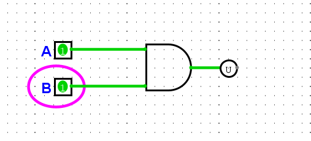 | A=1, B=1 → 输出 1 |
| 2 | 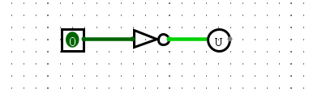 | 输入 0 → 输出 1 |
| 3 | 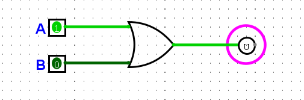 | A=0, B=1 → 输出 1 |
| 4 | 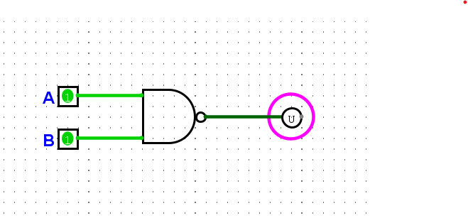 | A=1, B=1 → 输出 0 |
| 5 | 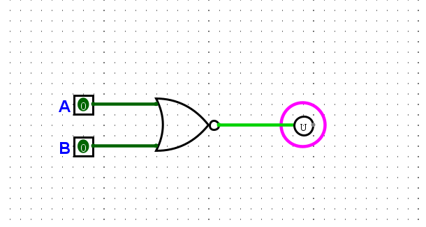 | A=0, B=0 → 输出 1 |
| 6 | 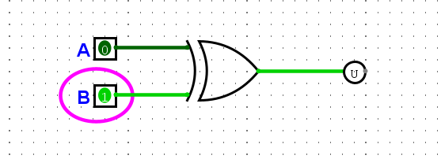 | A=1, B=0 → 输出 1 |

### 5. 仿真方法

```
① 打开对应的 .circ 文件
② 点击工具栏的【手形图标】进入仿真模式（鼠标变手形）
③ 点击输入引脚 A、B 切换 0 / 1
④ 观察输出引脚或探针的值
⑤ 对照真值表核对
```

**Logisim 中信号颜色的含义**：

| 颜色 | 含义 |
| --- | --- |
| 亮绿 | `1`（高电平）|
| 深绿 / 暗 | `0`（低电平）|
| **蓝色** | **高阻态（z）—— 这根线没有驱动源** |
| 红色 | 冲突（多个输出接到一起）|

---

## 实验二：译码器 / 编码器 / 数据选择器

> 这三个器件是**考核明确要求**的，也是 CPU 里最常用的组合逻辑模块。

### 1. 实验目的

- 掌握三种基本组合逻辑器件的功能与实现方法
- 理解它们之间的关系（**MUX = 译码器 + 与门 + 或门**）
- 为 sCPU 的**指令译码器**和**数据通路**做准备

### 2. 三者对比

| 器件 | 输入 → 输出 | 主要用什么门 | CPU 里用在哪 |
| --- | --- | --- | --- |
| **译码器** | n 位 → 2ⁿ 个输出（独热码）| 与门 + 非门 | **指令译码器**、地址译码器 |
| **编码器** | 2ⁿ 个输入 → n 位输出 | **或门** | 中断优先级、键盘编码 |
| **数据选择器** | 2ⁿ 路数据 + n 位选择 → 1 个输出 | 与门 + 或门 + 非门 | 选写回数据、选 PC 的下一个值 |

---

### 3. 2-4 译码器

📄 电路文件：[`decoder24.circ`](decoder24.circ)

**功能**：把 2 位二进制输入，转换成 4 个输出中**唯一一个为 1**（这就是「**独热码**」）。

**真值表**：

| A1 | A0 | Y3 | Y2 | Y1 | Y0 |
| :-: | :-: | :-: | :-: | :-: | :-: |
| 0 | 0 | 0 | 0 | 0 | **1** |
| 0 | 1 | 0 | 0 | **1** | 0 |
| 1 | 0 | 0 | **1** | 0 | 0 |
| 1 | 1 | **1** | 0 | 0 | 0 |

**逻辑式**（每个输出对应一种输入组合）：

```
Y0 = ¬A1 · ¬A0
Y1 = ¬A1 ·  A0
Y2 =  A1 · ¬A0
Y3 =  A1 ·  A0
```

**实现元件**：**2 个非门 + 4 个与门**

**仿真记录**：

| 截图 | 说明 |
| --- | --- |
| 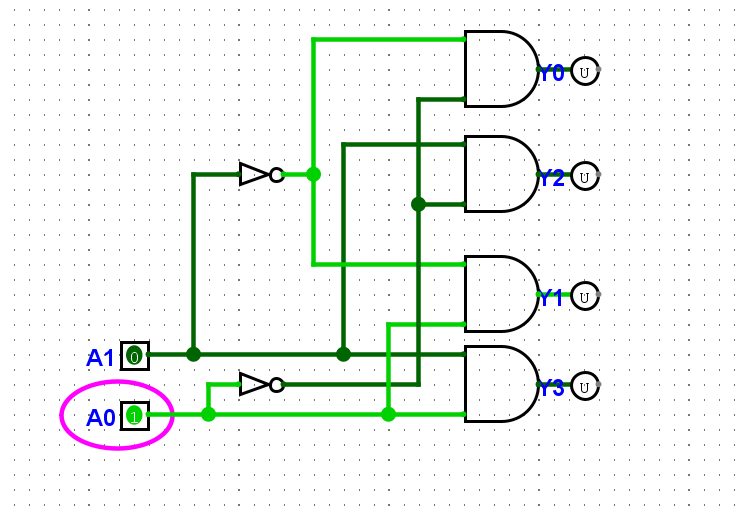 | A1A0 = 01 → **只有 Y1 为 1**（独热）|
| 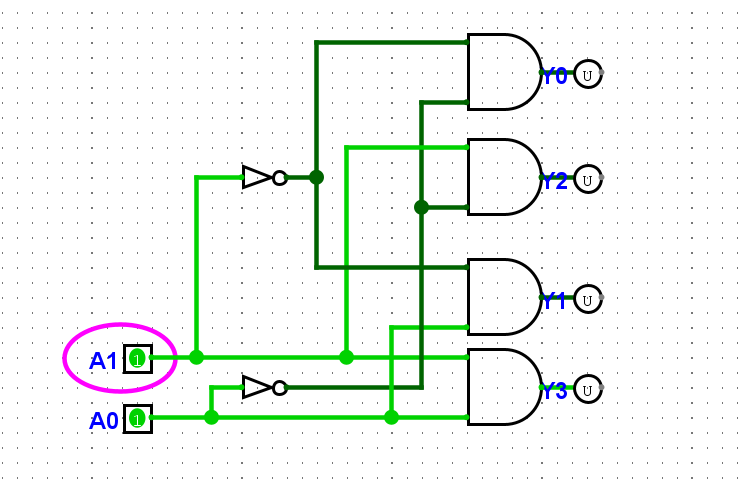 | A1A0 = 11 → **只有 Y3 为 1** |

> 💡 **关键观察**：**任何时刻只有 1 个输出是亮的** —— 这就是译码器的本质。

---

### 4. 4-2 编码器

📄 电路文件：[`encoder42.circ`](encoder42.circ)

**功能**：译码器的**逆操作** —— 4 个输入中**哪一个为 1**，就输出它的**编号**。

**真值表**：

| I3 | I2 | I1 | I0 | Y1 | Y0 | 编号 |
| :-: | :-: | :-: | :-: | :-: | :-: | :-: |
| 0 | 0 | 0 | **1** | 0 | 0 | 0 |
| 0 | 0 | **1** | 0 | 0 | 1 | 1 |
| 0 | **1** | 0 | 0 | 1 | 0 | 2 |
| **1** | 0 | 0 | 0 | 1 | 1 | 3 |

**逻辑式**（从真值表找规律）：

```
Y1 = I3 + I2        ← 看 Y1 何时为 1
Y0 = I3 + I1        ← 看 Y0 何时为 1
```

**实现元件**：**只需要 2 个或门**！（`I0` 不接任何门 —— 编号 0 是"默认状态"）

**仿真记录**：

| 截图 | 说明 |
| --- | --- |
| 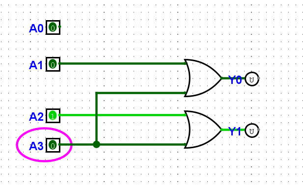 | I2=1 → Y1Y0 = **10**（编号 2）|
| 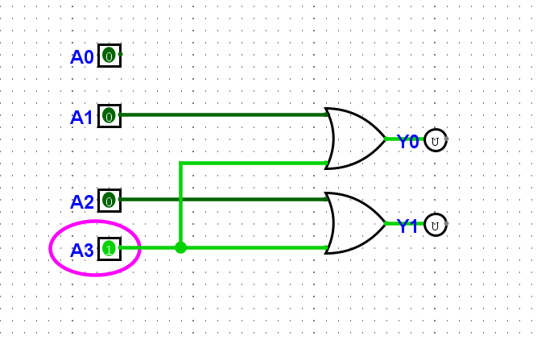 | I3=1 → Y1Y0 = **11**（编号 3）|

**⚠️ 这个编码器的局限**

它假设**同一时刻只有一个输入为 1**。如果多个输入同时为 1，输出就会出错。

**举例**：`I2` 和 `I1` 同时为 1

```
Y1 = I3 + I2 = 0 + 1 = 1
Y0 = I3 + I1 = 0 + 1 = 1
→ 输出 11 = 编号 3   ← 错！实际是两个键同时按
```

**真实电路用「优先编码器」**（如 **74LS148**）—— 给每个输入排**优先级**，多个同时有效时输出**编号最大**的那个。

---

### 5. 4 选 1 数据选择器（MUX）

📄 电路文件：[`mux41.circ`](mux41.circ)

**功能**：根据选择信号 `S1S0`，从 4 路数据中**选中一路**送到输出。

**真值表**：

| S1 | S0 | 输出 Y |
| :-: | :-: | --- |
| 0 | 0 | **D0** |
| 0 | 1 | **D1** |
| 1 | 0 | **D2** |
| 1 | 1 | **D3** |

**逻辑式**：

```
Y = ¬S1·¬S0·D0  +  ¬S1·S0·D1  +  S1·¬S0·D2  +  S1·S0·D3
    └────┬────┘     └────┬────┘     └────┬────┘     └────┬────┘
     S1S0=00          S1S0=01          S1S0=10          S1S0=11
```

**实现元件**：

| 元件 | 数量 | ⚠️ 关键设置 |
| --- | --- | --- |
| NOT Gate | 2 | 产生 ¬S1、¬S0 |
| **AND Gate** | 4 | **`Number of Inputs` 要改成 3** |
| **OR Gate** | 1 | **`Number of Inputs` 要改成 4** |

**每个与门的接法**：

| 与门 | 输入 1 | 输入 2 | 输入 3 |
| --- | --- | --- | --- |
| AND0 | ¬S1 | ¬S0 | **D0** |
| AND1 | ¬S1 | S0 | **D1** |
| AND2 | S1 | ¬S0 | **D2** |
| AND3 | S1 | S0 | **D3** |

**仿真记录**：

| 截图 | 说明 |
| --- | --- |
| 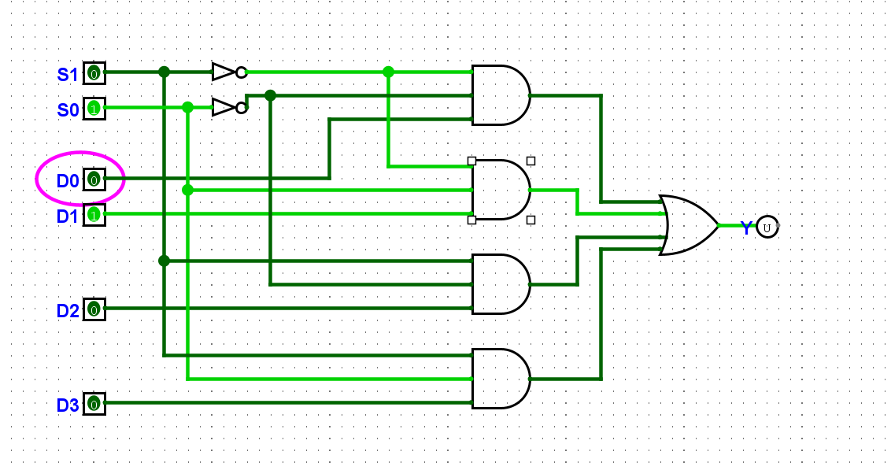 | S1S0 = 00，D0 = 1 → **Y = 1**（选中 D0）|

---

### 6. 💡 三者之间的关系（核心理解）

```
译码器：   n 位  ──────→  2ⁿ 个输出（独热码）
编码器：   2ⁿ 个输入  ──→  n 位输出
MUX：      2ⁿ 路数据 + n 位选择  ──→  1 个输出
                              ↑
                     选择信号 = 译码器的输出
```

**一句话总结**：

> **MUX = 译码器 + 与门 + 或门**
>
> | 部件 | 作用 |
> | --- | --- |
> | **译码器** | 决定「**选哪一路**」（输出独热码）|
> | **与门** | 把没选中的路「**关掉**」（输出 0）|
> | **或门** | 把选中的那一路「**放行**」出去 |

**对照验证**：4 选 1 MUX 的 4 个与门，它们的「选择信号输入」正好就是 **2-4 译码器的 4 个输出** —— 说明两者是同一套思路。

---

### 7. 实验结论

1. **译码器用与门，编码器用或门** —— 一个漂亮的对称：
   - **译码器**要求**所有条件同时满足**（与）
   - **编码器**只要**任一条件满足**即可（或）

2. **MUX 本质上是「译码器 + 数据门控」** —— 理解了译码器，MUX 就水到渠成。

3. **门的输入数量可以修改** —— 通过属性栏的 **`Number of Inputs`**，2 输入与门可以变成 3 输入、4 输入。

4. **两个重要的排错信号**：
   - **红线** = 冲突（多个输出接到了同一条线上）
   - **蓝线** = 高阻（这条线没有任何驱动源）

   > 搭 sCPU 时，**这两种颜色是最快的排错入口**。

5. **验证方法**：**文件坐标只能"推测"电路逻辑，真正的判据永远是仿真结果** —— 这次分析中就出现过「按坐标推断错误、但仿真实际正确」的情况。

---

## 实验三：七段数码管译码器

> 译码器的**实战应用** —— 把 4 位二进制数字变成数码管的 7 段显示。

📄 电路文件：`seg7_rom.circ`

### 1. 实验目的

- 把「译码器」的概念用到实际显示器件上
- 掌握**七段数码管**的段码编码
- 学习**用 ROM 查表**实现复杂组合逻辑（真实芯片的常见做法）

### 2. 七段数码管的结构

```
      a
    ┌─────┐
  f │     │ b
    ├──g──┤
  e │     │ c
    └─────┘
      d
```

**7 段**：`a b c d e f g`

| 类型 | 特点 | Logisim 设置 |
| --- | --- | --- |
| **共阴极** | 输入 `1` = 点亮 | 勾选 `Common Cathode` |
| 共阳极 | 输入 `0` = 点亮 | 不勾选 |

**本实验用共阴极**（1 = 亮，符合直觉）。

### 3. 真值表与段码

| 数字 | D3 D2 D1 D0 | a | b | c | d | e | f | g | **段码**（abcdefg）| 十六进制 |
| :-: | :-: | :-: | :-: | :-: | :-: | :-: | :-: | :-: | :-: | :-: |
| 0 | 0000 | 1 | 1 | 1 | 1 | 1 | 1 | 0 | 1111110 | **7E** |
| 1 | 0001 | 0 | 1 | 1 | 0 | 0 | 0 | 0 | 0110000 | **30** |
| 2 | 0010 | 1 | 1 | 0 | 1 | 1 | 0 | 1 | 1101101 | **6D** |
| 3 | 0011 | 1 | 1 | 1 | 1 | 0 | 0 | 1 | 1111001 | **79** |
| 4 | 0100 | 0 | 1 | 1 | 0 | 0 | 1 | 1 | 0110011 | **33** |
| 5 | 0101 | 1 | 0 | 1 | 1 | 0 | 1 | 1 | 1011011 | **5B** |
| 6 | 0110 | 1 | 0 | 1 | 1 | 1 | 1 | 1 | 1011111 | **5F** |
| 7 | 0111 | 1 | 1 | 1 | 0 | 0 | 0 | 0 | 1110000 | **70** |
| 8 | 1000 | 1 | 1 | 1 | 1 | 1 | 1 | 1 | 1111111 | **7F** |
| 9 | 1001 | 1 | 1 | 1 | 1 | 0 | 1 | 1 | 1111011 | **7B** |
| 10~15 | — | 0 | 0 | 0 | 0 | 0 | 0 | 0 | 0000000 | **00** |

**记忆技巧**：

| 数字 | 特点 |
| --- | --- |
| **0** | 除 `g` 外全亮 |
| **1** | 只有 `b`、`c` |
| **7** | 只有 `a`、`b`、`c`（比 1 多个 `a`）|
| **8** | **全亮** |

### 4. 两种实现方案

#### 方案 A：用逻辑门直接实现

设 `A=D3, B=D2, C=D1, D=D0`，用卡诺图化简得：

```
a = A + C + B·D + ¬B·¬D
b = ¬B + ¬C·¬D + C·D
c = ¬C + D + B
d = A + ¬B·¬C + B·¬C·¬D + ¬B·C·D
e = ¬B·¬D + C·¬D
f = A + C·¬D + B·¬D + B·¬C
g = A + B·¬C + ¬B·C + C·¬D
```

**元件需求**：4 个非门 + **约 20 个与门/或门**

**缺点**：门太多，连线复杂，容易出错。

#### ⭐ 方案 B：用 ROM 查表（本实验采用）

**思路**：**把真值表直接"烧"进 ROM** —— 4 位地址进，7 位段码出。

```
4 位输入  ──→  ROM 地址
                  ↓
              7 位段码
                  ↓
             Splitter 拆成 7 路
                  ↓
              数码管 a~g
```

**ROM 设置**：

| 属性 | 值 |
| --- | --- |
| `Address Bit Width` | **4** |
| `Data Bit Width` | **7** |
| `Contents` | `7E 30 6D 79 33 5B 5F 70 7F 7B 00 00 00 00 00 00` |

**Splitter 设置**：

| 属性 | 值 |
| --- | --- |
| `Input Bit Width` | **7** |
| `Fan Out` | **7** |

**优点**：

| 优点 | 说明 |
| --- | --- |
| **一个元件搞定** | 不用画 20 多个门 |
| **真实电路就这么做** | 数码管驱动芯片本质就是查表 |
| **易修改** | 想显示字母（A~F）只要改表格 |
| **逻辑清晰** | 「输入地址 → 输出数据」，一眼看懂 |

### 5. 仿真记录

| 截图 | 说明 |
| --- | --- |
| 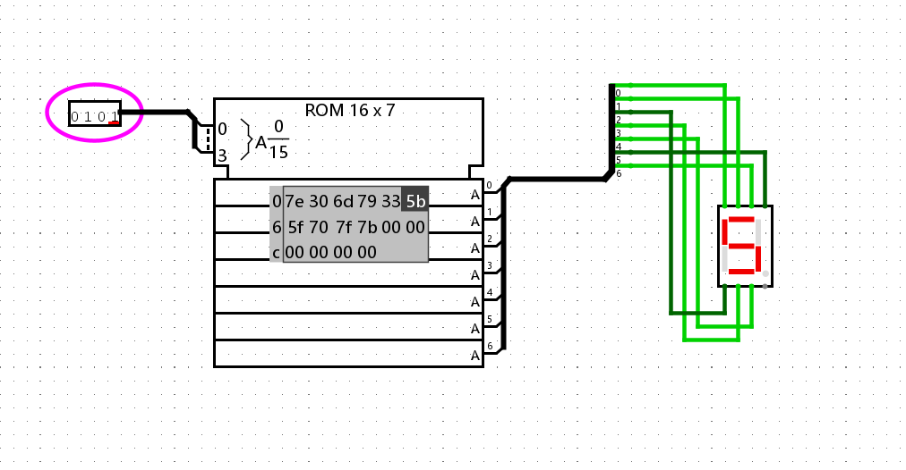 | 输入 `0101`（=5）→ 数码管显示 **「5」** |
| 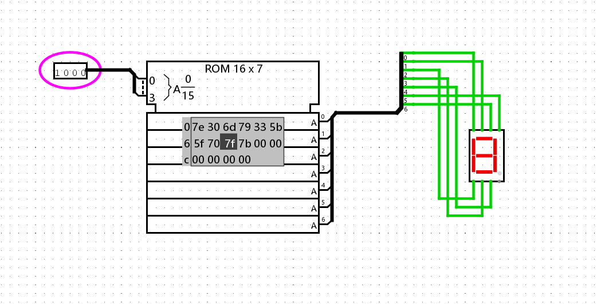 | 输入 `1000`（=8）→ 数码管显示 **「8」**（全亮）|

**截图里还能看到 ROM 的 Contents 表格**，可以直接核对段码是否正确。

### 6. ⭐ 调试记录：用「已知输入」反推接线错误

**现象**：电路搭好后，输入 `4` 但数码管显示的不是「4」。

**排查过程**：

**第一步：先确认所有线都接上了**

```
输入 8 → 段码是 1111111，应该 7 段全亮
结果：全亮 ✅ → 说明 7 根线都通了，问题在「哪根接到哪一段」
```

**第二步：用已知输入反推映射**

| 输入 | 值为 1 的位 | 实际亮的段 |
| :-: | :-: | --- |
| 1 | bit5, bit4 | **d, e** |
| 4 | bit5, bit4, bit1, bit0 | **d, e, f, g** |
| 2 | bit6, bit5, bit3, bit2, bit0 | **a, b, c, d, g** |

**推理**：

```
输入1 → 只有 bit5、bit4 为 1 → 亮的 d、e 就是接在这两位上
输入4 → 又多出 f、g → 它们接的是 bit1、bit0
输入2 → 交叉验证：g 亮且 bit0 在集合里 → g 接 bit0，f 接 bit1
                      d 亮且 bit5 在集合里 → d 接 bit5，e 接 bit4
```

**得出的完整映射**：

| 数码管段 | 实际接的位 | 正确应该是 |
| --- | :-: | :-: |
| a | bit 6 | bit 6 ✅ |
| **b** | **bit 3** | **bit 5** ❌ |
| **c** | **bit 2** | **bit 4** ❌ |
| **d** | **bit 5** | **bit 3** ❌ |
| **e** | **bit 4** | **bit 2** ❌ |
| f | bit 1 | bit 1 ✅ |
| g | bit 0 | bit 0 ✅ |

**结论**：**`b↔d` 两根线接反了，`c↔e` 两根线也接反了**。

**第三步：交换这两对线 → 全部数字显示正确** ✅

**经验总结**：

> **这是一个很实用的调试方法** —— 当"输出整体不对但都有反应"时，
> **用几个「只有少数几位为 1」的输入**，就能**反推出每一位实际接到了哪里**，
> 而不需要一根根线去查。

### 7. 实验结论

1. **ROM 查表是实现复杂组合逻辑的利器** —— 20 多个门才能实现的译码，一个 ROM 就搞定了。
2. **实际芯片也这么干** —— 数码管驱动、字符显示、微码控制，本质都是「地址 → 数据」的查表。
3. **七段数码管是"译码器"最直观的应用** —— 输入一个编号，输出"点亮哪几盏灯"。
4. **调试方法比调试结果更重要** —— 这次用「已知输入反推接线」的思路，可以推广到后面搭 CPU 时的排错。

---

## 实验四：加法器与比较器

> **加法器是 CPU 里 `add` 指令的硬件** —— 这是从「组合逻辑」迈向「运算部件」的关键一步。

📄 电路文件：`haifadder.circ`（半加器）、`fulladder.circ`（全加器）、`adder4.circ`（4 位加法器）、`comparator.circ`（比较器）

### 1. 实验目的

- 掌握**二进制加法**的电路实现
- 学会把简单模块**组合**成复杂部件（**子电路**）
- 理解「进位」在运算电路中的作用
- 为 sCPU 的 ALU 打基础

---

### 2. 半加器（Half Adder）

**功能**：两个 1 位数相加。

**真值表**：

| A | B | **S**（和）| **C**（进位）|
| :-: | :-: | :-: | :-: |
| 0 | 0 | 0 | 0 |
| 0 | 1 | 1 | 0 |
| 1 | 0 | 1 | 0 |
| 1 | 1 | **0** | **1** |

> 💡 `1 + 1 = 10`（二进制）—— 本位 0，进位 1。

**逻辑式**：

```
S = A ⊕ B        ← A、B 不同时为 1
C = A · B        ← A、B 同时为 1
```

**元件**：**1 个 XOR + 1 个 AND**（只用两个门！）

**仿真记录**：

| 截图 | 说明 |
| --- | --- |
| 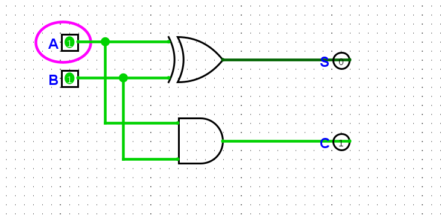 | A=1, B=1 → **S=0, C=1**（即 `1+1=10`）|

---

### 3. 全加器（Full Adder）

**功能**：两个 1 位数 **加上低位来的进位**。

**真值表**：

| A | B | Cin | **S** | **C** |
| :-: | :-: | :-: | :-: | :-: |
| 0 | 0 | 0 | 0 | 0 |
| 0 | 0 | 1 | 1 | 0 |
| 0 | 1 | 0 | 1 | 0 |
| 0 | 1 | 1 | 0 | 1 |
| 1 | 0 | 0 | 1 | 0 |
| 1 | 0 | 1 | 0 | 1 |
| 1 | 1 | 0 | 0 | 1 |
| 1 | 1 | 1 | 1 | 1 |

**逻辑式**：

```
S = A ⊕ B ⊕ Cin
C = A·B + Cin·(A ⊕ B)
```

**元件**：**2 个 XOR + 2 个 AND + 1 个 OR**

**注意**：**`A ⊕ B` 这个中间信号要用两次**（一次给第二个 XOR，一次给 AND）—— 从同一条线上拉分支。

**仿真记录**：

| 截图 | 说明 |
| --- | --- |
| 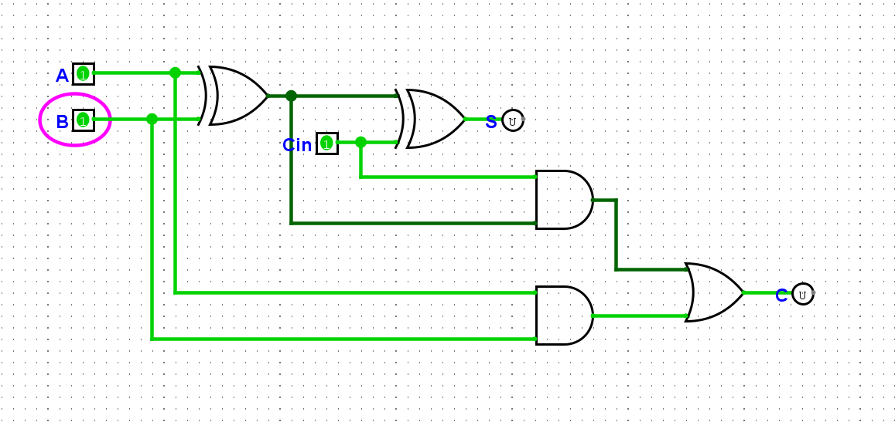 | A=1, B=1, Cin=1 → **S=1, C=1**（即 `1+1+1=11`）|

---

### 4. ⭐ 4 位加法器（子电路 + 进位串联）

**功能**：把两个 4 位数相加，输出 4 位和 + 1 位进位。

**结构**：**4 个全加器串联**，进位逐级向上传递。

```
        Cin = 0
          ↓
A0 B0 →[FA0]→ S0
          ↓ C
A1 B1 →[FA1]→ S1
          ↓ C
A2 B2 →[FA2]→ S2
          ↓ C
A3 B3 →[FA3]→ S3
          ↓
        Cout（溢出）
```

#### 🔧 关键技术：子电路（Subcircuit）

**问题**：4 个全加器 = 24 个门，直接画会乱成一团。

**解决**：**把全加器封装成一个「黑盒子」**。

```
① Project → Add Circuit... → 命名 fulladder
② 在 fulladder 页里画全加器（门电路 + 5 个引脚）
③ 回 main 页，从左侧元件库拖 4 个 fulladder 方块
④ 每个方块只有 5 个端口，画布非常干净
```

**子电路的端口规则**：

| 子电路里的引脚 | 会变成方块的 |
| --- | --- |
| **输入引脚**（`Output? = No`）| **左侧输入端口** |
| **输出引脚**（`Output? = Yes`）| **右侧输出端口** |

**⚠️ 这就是最容易踩的坑** —— 见后面「调试记录」。

**仿真记录**：

| 截图 | 说明 |
| --- | --- |
| 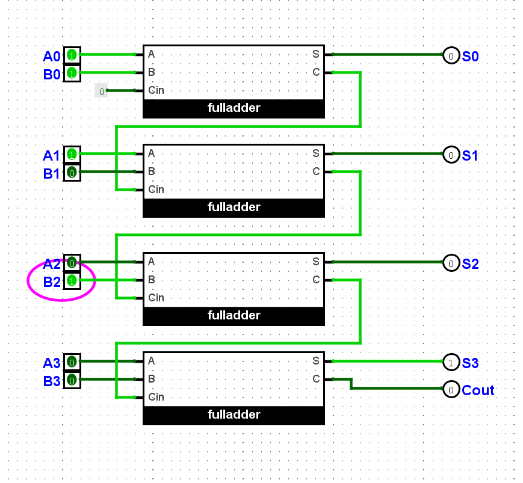 | A=3, B=5 → **S=8, Cout=0**（不溢出）|
| 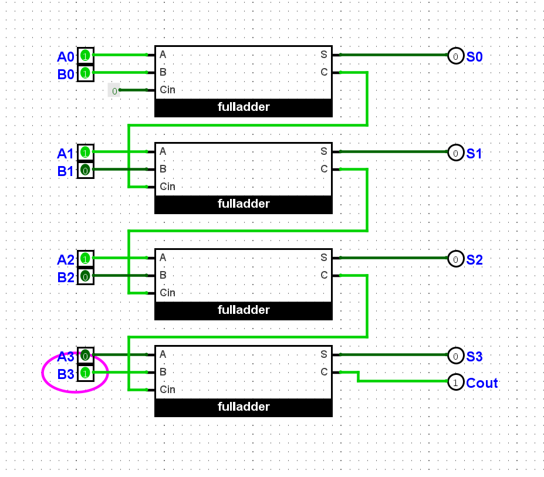 | 大数相加 → **Cout=1**（溢出）|
| 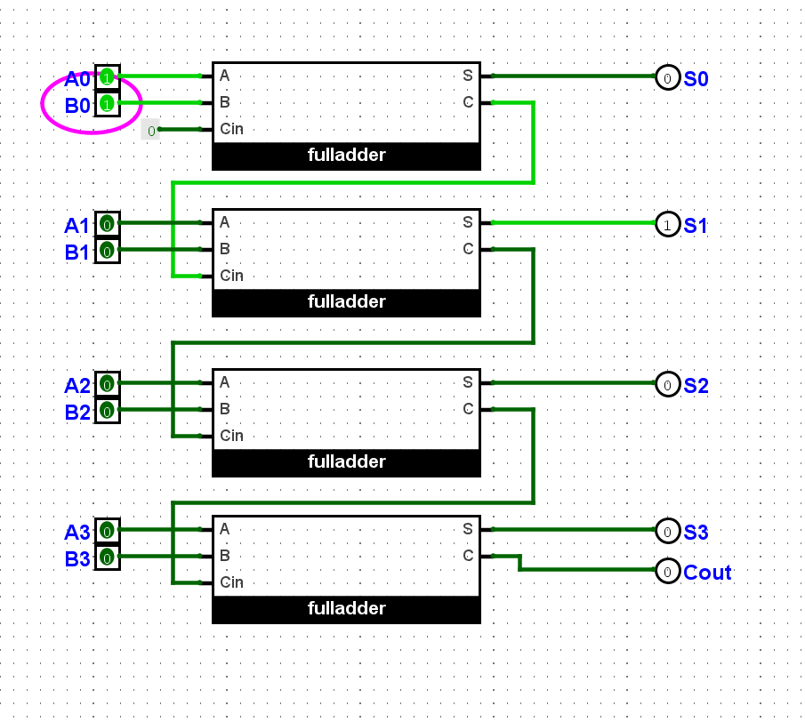 | A=1, B=1 → **S=2** |

> **溢出的意义**：4 位最多表示 15，两个数相加超过 15 时，`Cout` 输出 1。
> 后面搭 CPU 时，这个进位还会用来做**减法**和**比较大小**。

---

### 5. 比较器（Comparator）

**功能**：比较两个 1 位数的大小关系。

**真值表**：

| A | B | **A>B** | **A=B** | **A<B** |
| :-: | :-: | :-: | :-: | :-: |
| 0 | 0 | 0 | **1** | 0 |
| 0 | 1 | 0 | 0 | **1** |
| 1 | 0 | **1** | 0 | 0 |
| 1 | 1 | 0 | **1** | 0 |

**逻辑式**：

```
A>B = A · ¬B          ← "我大你小"
A<B = ¬A · B          ← "我小你大"
A=B = ¬(A ⊕ B)        ← "咱俩一样"（异或取反）
```

**元件**：**3 个 NOT + 2 个 AND + 1 个 XOR**

**仿真记录**：

| 截图 | 说明 |
| --- | --- |
| 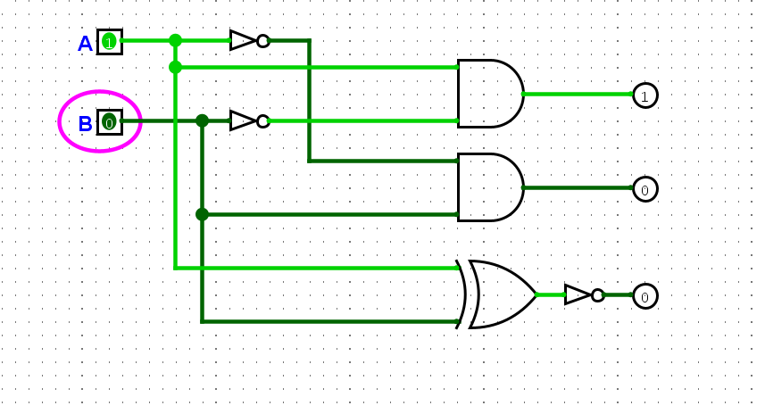 | A=1, B=0 → **A>B 亮** |
| 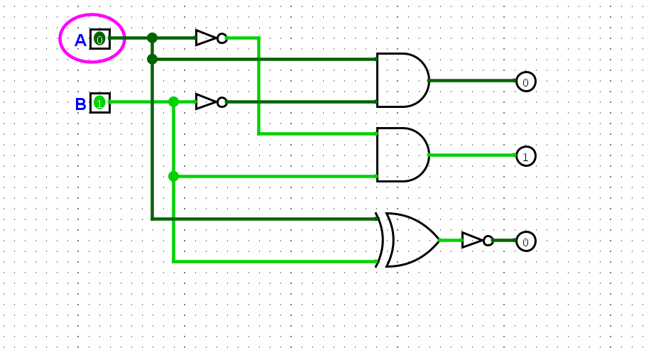 | A=0, B=1 → **A<B 亮** |

**判据**：**任何输入组合下，只有 1 个输出是亮的**（三种关系互斥）。

---

### 6. ⭐ 调试记录：子电路输出全是「蓝线」

**现象**：4 位加法器搭好后，**`S0` 是绿的，但 `S1`、`S2`、`S3`、`Cout` 全是蓝色的**。

**蓝线 = 高阻态 = 这个信号没有被任何东西驱动。**

#### 诊断过程

**第一步：看「蓝色出现在哪一段」**

```
FA0 的 S → S0   ：绿色 ✅
FA0 的 C → FA1.Cin：蓝色 ❌
S1、S2、S3       ：蓝色（被上一步拖累）
```

**关键发现**：**同一个子电路方块，`S` 端口正常，`C` 端口却不输出**。

**第二步：对比两个引脚的属性**

切到 `fulladder` 页，逐个点引脚看属性：

| 引脚 | `Output?` | 结论 |
| --- | --- | --- |
| `A`、`B`、`Cin` | `No` | 输入 ✅ |
| `S` | **`Yes`** | 输出 ✅ |
| **`C`** | **`No`** ❌ | **错误！它应该是输出** |

**第三步：把 `C` 改成 `Output? = Yes`** → **所有线变绿** ✅

#### 根本原因

**子电路方块的「端口方向」完全由子电路内部引脚的 `Output?` 属性决定**：

```
引脚 Output? = No   →  方块上显示为【输入端口】（左侧），且不驱动外部
引脚 Output? = Yes  →  方块上显示为【输出端口】（右侧），驱动外部
```

**如果输出引脚忘记设成 `Yes`** → **方块上虽然位置在右边（因为 `Facing` 是 West），但它不驱动外部** → **外部连线全是蓝的**。

#### 排查方法总结

> **当子电路「整体不输出」时，最有效的方法是：**
> **找一个"正常工作的同类端口"和"不工作的端口"做对比** ——
> **同一个方块里 `S` 绿、`C` 蓝，说明它们内部设置不同** → **立刻去查引脚属性**。

---

### 7. 实验结论

1. **加法器的核心是「异或 + 与」**：
   - `S = A ⊕ B`（不同为 1，对应加法不进位）
   - `C = A · B`（同为 1 才进位）
   - 这在实验一学异或门时就已经埋下伏笔了。

2. **全加器 = 半加器 + 进位处理** —— **复杂部件由简单模块组合而成**，这是数字电路的基本思想。

3. **子电路是管理复杂度的关键工具**：
   - 4 位加法器用 4 个「全加器方块」，画布很干净
   - 搭 CPU 时，ROM、GPR、ALU 都会做成子电路
   - **但要注意端口方向** ⚠️

4. **进位不只是"溢出标志"**：
   - 加法器里它是级联的纽带
   - **后面做减法（用补码）和比较大小都要用到它**

5. **调试方法**：**对比法** —— 找正常和不正常的同类端口对比，比逐个检查快得多。

---

## 实验五：时序逻辑与存储器

> 前面所有实验都是「**组合逻辑**」—— 输入决定输出，算完就忘。
> 从这个实验开始，电路要**记住状态**了：**触发器 → 寄存器 → 计数器 → RAM**。

📄 电路文件：`dff.circ`、`register4.circ`、`counter4.circ`、`ram84.circ`、`ram44.circ`
（另含补充：`sub4.circ`、`comparator4.circ`）

---

### 1. 组合逻辑 vs 时序逻辑

| | 组合逻辑（实验一~四）| **时序逻辑（本实验）** |
| --- | --- | --- |
| **输出** | 只由**当前输入**决定 | 由输入 **+ 之前存的状态**决定 |
| **时钟** | 不需要 | **必须有** |
| **典型电路** | 译码器、加法器、MUX | **触发器、寄存器、计数器、RAM** |

> **CPU 之所以能"一步步执行指令"，就是因为有时钟和寄存器。**

---

### 2. 从锁存器到触发器（存储的进化史）

#### ① SR 锁存器：两个门"互相牵制"

**核心是交叉耦合**：

```
        ┌─────────┐
S ──────┤1        │
     ┌──┤2  NOR   ├───┬───→ Q
     │  └─────────┘   │
     │  ┌─────────┐   │
     └──┤1        ├───┘
R ──────┤2  NOR   ├───────→ Q̄
        └─────────┘
```

| S | R | Q（下一个）| 说明 |
| :-: | :-: | :-: | --- |
| **0** | **0** | **保持** | ⭐ 记住之前的值 |
| 0 | 1 | 0 | 复位 |
| 1 | 0 | 1 | 置位 |
| **1** | **1** | ❌ 不确定 | **禁止** |

**关键实验现象**：**S 从 1 变回 0 后，Q 仍然是 1** —— **输入撤销了，状态却记住了** ✅

**这就是"存储"的本质** —— 前面所有电路都做不到这件事。

#### ② D 锁存器：消除禁止状态

**改进**：`D` 接 S、`¬D` 接 R（加一个非门），**S 和 R 永远相反**。

**再加两个与门 + `EN` 信号** → **门控 D 锁存器**：

| EN | D | Q |
| :-: | :-: | :-: |
| **1** | 0/1 | **跟着 D 变**（透明）|
| **0** | 任意 | **保持** |

**元件**：2 NOR + 1 NOT + 2 AND

#### ③ D 触发器：从"电平触发"到"边沿触发"

| | D 锁存器 | **D 触发器** |
| --- | --- | --- |
| 触发方式 | **电平**（EN 高电平全程透明）| **边沿**（只在上升沿采样）|
| D 变化时 | EN=1 时 Q 立刻跟着变 | **只有打拍才变** |
| 抗干扰 | 差（会"穿透"）| **好** ✅ |
| CPU 里用哪个 | 基本不用 | **用这个** |

**D 触发器真值表**：

| 时钟 | D | Q |
| :-: | :-: | :-: |
| **↑** | 0 | 变成 0 |
| **↑** | 1 | 变成 1 |
| 其他 | × | **保持** |

**元件**：Logisim 的 `Memory → D Flip-Flop`

**⭐ 关键实验**（体会"边沿触发"）：

| 步骤 | D | 打拍 | Q | 说明 |
| :-: | :-: | :-: | :-: | --- |
| 1 | 1 | ❌ | **0** | ⭐ **D 变了，Q 不变** |
| 2 | 1 | ✅ | **1** | 采样了 |
| 3 | 0 | ❌ | **1** | ⭐ **Q 还记得 1** |
| 4 | 0 | ✅ | **0** | 更新了 |

**「D 变了但 Q 不变，直到打拍才变」** —— 这就是"记忆"。

**打拍方法**：**`Ctrl + T`**（Logisim 单步打一拍）

---

### 3. 4 位寄存器（Register）

**本质**：**多个 D 触发器并联，共用同一个时钟**。

**Logisim 元件**：`Memory → Register`（`Data Bits = 4`）

**关键引脚**：

| 引脚 | 作用 |
| --- | --- |
| `D`（4 位）| 数据输入 |
| `Clock` | 时钟 |
| **`WE` / `Enable`** | ⭐ **写使能**（=1 才写入）|
| `Q`（4 位）| 数据输出 |

**⭐ 写使能的关键实验**：

| 步骤 | D | WE | 打拍后 Q |
| :-: | :-: | :-: | :-: |
| 1 | 5 | 1 | **5** |
| 2 | 9 | 1 | **9** |
| 3 | 12 | **0** | **9** ⭐ 没写进去 |
| 4 | 12 | 1 | **12** |

**为什么需要写使能**：

```
执行 add r0, r1, r2 时：
   r0 要被写入   →  WE = 1
   r1、r2 不能变 →  WE = 0
```

**如果没有写使能，一条指令会破坏所有寄存器** ❌

---

### 4. 4 位计数器（Counter）

**本质**：**寄存器 + 加法器 + 反馈**

```
        ┌──────────────────────────┐
        │          反馈            │
        ↓                          │
   常量1 →[加法器]──→[寄存器]──────┴──→ 输出 Q
                       ↑
                     时钟
```

**三步循环**：
1. 寄存器存当前值
2. 加法器把当前值 **+1**
3. 结果送回寄存器（下一个时钟沿写回）

**Logisim 元件**：`Memory → Counter`（`Data Bits = 4`）

**⭐ 关键实验**：

| 打拍次数 | Q |
| :-: | :-: |
| 0 | 0 |
| 1 | 1 |
| … | … |
| 15 | 15 |
| **16** | **0** ⭐（模 16，溢出回绕）|

> ⭐ **这就是 PC（程序计数器）的原型** —— 每执行一条指令就 +1。

---

### 5. 存储器：ROM 与 RAM

| | **ROM** | **RAM** |
| --- | --- | --- |
| 能写吗 | ❌ 内容固定 | ✅ **可以读写** |
| 用途 | 存程序、字模 | **存变量、数据** |
| CPU 里 | 指令存储器 | **GPR** |

**已做过 ROM**：[实验三](.#实验三七段数码管译码器) 的七段数码管段码表就是 ROM 查表。

#### RAM 的内部结构

```
地址 ──→[地址译码器]──→ 选中一行
                          ↓
              ┌─────────────────────┐
              │  存储阵列            │←── 数据输入
              │  行0 行1 行2 … 行7   │
              └─────────────────────┘──→ 数据输出
                          ↑
                   写使能 WE（1=写，0=读）
```

**关键洞察**：

> **RAM = 地址译码器 + 存储阵列 + 读写控制**
>
> | 部件 | 对应学过的 |
> | --- | --- |
> | 地址译码器 | ✅ 2-4 译码器（实验二）|
> | 存储单元 | ✅ D 触发器（本实验）|
> | 读写控制 | ✅ 写使能（寄存器）|
>
> **全是学过的东西拼起来的** ✅

#### 方式 A：用 Logisim 现成的 RAM（8×4）

**元件**：`Memory → RAM`

**属性**：

| 属性 | 值 |
| --- | --- |
| `Address Bit Width` | **3**（8 个单元）|
| `Data Bit Width` | **4** |
| `Synchronous Read` | `No`（组合读）|

**引脚**（Logisim 的标记）：

| 标记 | 作用 |
| --- | --- |
| `A` | 地址输入 |
| `D`（左）| 数据输入 |
| **`M2 [Write enable]`** | ⭐ **写使能** |
| **`M1 [Output enable]`** | 输出使能（接常量 1）|
| `C1` | 时钟 |
| `D`（右）| 数据输出 |

**⭐ 关键实验 —— 地址"路过"不会误写**：

```
① Addr = 1，Din = 1111，WE = 1
② 【先别打拍】，把 Addr 依次改成 2、3、4
③ 停在 Addr = 4，【这时才打拍】
④ 分别读地址 1~4：
     地址 4 → 1111  ✅（打拍时写入）
     地址 1、2、3 → 0000  ✅（只是路过）
```

**证明了**：**写操作只在时钟沿发生** —— **地址变化过程中不会误写** ✅

**这正是"为什么写要有时钟"的答案**。

#### ⭐ 方式 B：手工搭 4×4 RAM（理解内部结构）

**用做过的模块拼**：

| 部件 | 作用 |
| --- | --- |
| **2-4 译码器** | 把地址变成独热码，**选中一个寄存器** |
| **与门 ×4** | **`译码输出 · WE`** → 只有选中的能写 |
| **4 位寄存器 ×4** | 真正的存储单元 |
| **4 选 1 MUX** | 根据地址，**把选中寄存器的数据送出来** |

**结构**：

```
                ┌───────────────────────────────┐
地址(2位) ──┬──→│ ① decoder24 → 选中一个寄存器   │
            │   └───────────────────────────────┘
            │
            └──→│ ② mux41 → 读出选中的寄存器     │
                └───────────────────────────────┘

WE ──→[与门×4]──→ 各寄存器的 Enable
Din(4位) ──────→ 4 个寄存器的 D（广播）
Clock ────────→ 4 个寄存器的 Clock
4 个寄存器 Q ──→ mux41 的 D0~D3
mux41 输出 ────→ Dout
```

**写路径**（地址决定写哪个）：

```
Addr=01 → decoder24 输出 0010 → 只有 Y1=1
        → AND1 = Y1 · WE = 1
        → Register1 的 Enable = 1
        → 时钟沿：只有 Register1 写入 ✅
        → 其他寄存器 Enable=0，保持不变 ✅
```

**读路径**（地址决定读哪个）：

```
Addr=01 → mux41 的 S1S0 = 01
        → MUX 输出 = D1 = Register1.Q ✅
```

> 💡 **这就是 sCPU 里 GPR（通用寄存器堆）的简化版** —— 地址就是寄存器编号。

**⚠️ 踩坑记录：MUX 的位宽**

原来的 `mux41` 是 **1 位**的（D0~D3 各 1 位），但 RAM 要选 **4 位**数据。

**解决**：**把 mux41 子电路里的引脚和门都改成 `Data Bits = 4`** —— Logisim 的与门/或门支持多位操作 ✅

---

### 6. 补充实验：减法器与 4 位比较器

#### 减法器（sub4.circ）—— 补码的应用

**原理**：

```
A − B  =  A + ¬B + 1
```

**做法**（在 4 位加法器上改两处）：

```
① B0~B3 每个输入后面加 1 个 NOT 门（取反）
② FA0 的 Cin 从常量 0 改成常量 1
```

**验证**：

| A | B | 结果（4 位）| 有符号解释 |
| :-: | :-: | :-: | :-: |
| 5 | 3 | 0010 | **+2** ✅ |
| 3 | 5 | **1110** | **−2** ✅ |
| 7 | 7 | 0000 | 0 ✅ |

**「同一串比特，两种解释」**：

```
1110
  · 无符号看 = 14
  · 有符号看 = −2      ← 正确答案
```

**这就是补码的巧妙之处** —— **不需要专门的减法电路** ✅

**顺带**：**减法时 `Cout` 变成"借位标志"**：

| 情况 | Cout |
| --- | :-: |
| A ≥ B | 1（无借位）|
| A < B | 0（有借位）|

**—— 这正好可以用来判断大小**（真实 CPU 的 ALU 就这么做）。

#### 4 位比较器（comparator4.circ）—— 级联设计

**核心思想**：**从最高位往低位比较，高位能分出胜负就不看低位**。

**1 位比较器模块**（带级联端口）：

```
本位计算：
  gt = A · ¬B
  lt = ¬A · B
  eq = ¬(A ⊕ B)

输出（考虑高位结论）：
  GT_out = gt + eq · GT_in
  LT_out = lt + eq · LT_in
  EQ_out = eq · EQ_in
```

**级联**：**4 个模块串联，从最高位到最低位**

```
  常量(0,0,1) → [cmp1(A3,B3)] → [cmp1(A2,B2)] → [cmp1(A1,B1)] → [cmp1(A0,B0)] → 输出
```

**最高位的初始值**：`GT_in=0, LT_in=0, EQ_in=1`（表示"暂时还没分出胜负"）

---

### 7. ⭐ 调试记录

#### 坑 1：SR 锁存器的交叉连线出现红线

**现象**：两个 NOR 门交叉耦合后，线显示红色（冲突）。

**原因**：**Logisim 里，线只要【经过】某个引脚就算连接** —— 交叉线"绕远"时**碰到了另一个门的输出点** → **两个输出被短接**。

**解决**：**用 `Tunnel`（隧道）代替长线** —— 同名隧道自动连通，不用画线，**不可能碰到别的引脚**。

**这也是搭 CPU 的必备技能**（数据通路几百根线，全靠隧道）。

#### 坑 2：D 锁存器里 red 线

**原因同上** —— 交叉耦合的两条线**经过了对侧门的输出**。

#### 坑 3：手工 RAM 的 MUX 位宽不匹配

**现象**：Dout 显示为蓝色（高阻）。

**原因**：`mux41` 原来是 1 位的，无法选择 4 位数据。

**解决**：把 `mux41` 里所有引脚和门都改成 `Data Bits = 4`。

---

### 8. 仿真记录

#### 4 位寄存器（写使能）

| 截图 | 说明 |
| --- | --- |
| 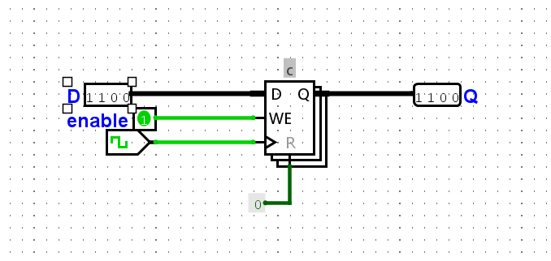 | `WE=0` 时打拍，Q 保持不变 |

#### 4 位计数器

| 截图 | 说明 |
| --- | --- |
| 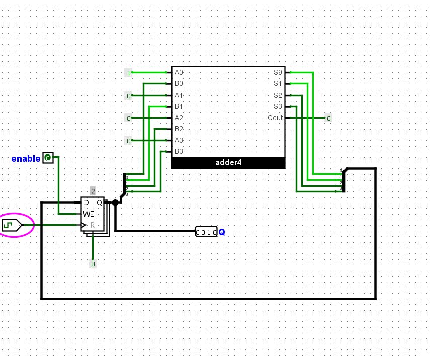 | 每个时钟沿 +1，到 15 后回到 0 |

#### 8×4 RAM（现成元件，方式 A）

| 截图 | 说明 |
| --- | --- |
| 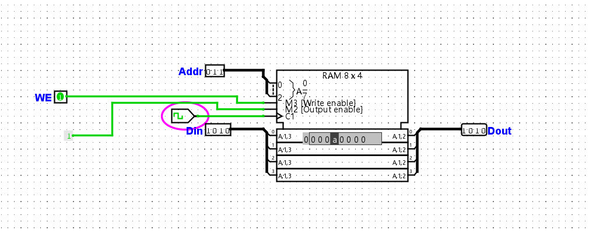 | 写入地址 3 = 1010 |
| 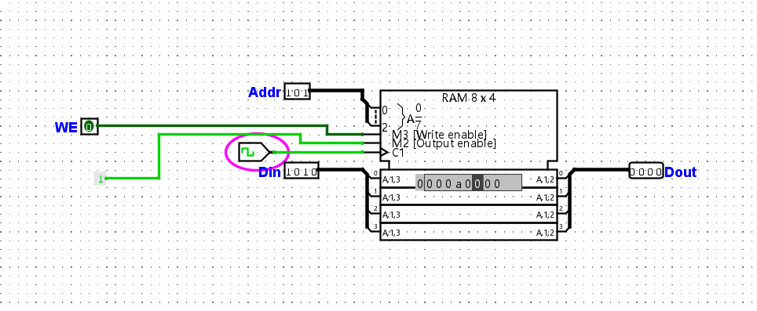 | 读没写过的地址 → `0000` |

#### 4×4 RAM（手工搭建，方式 B）★

| 截图 | 说明 |
| --- | --- |
| 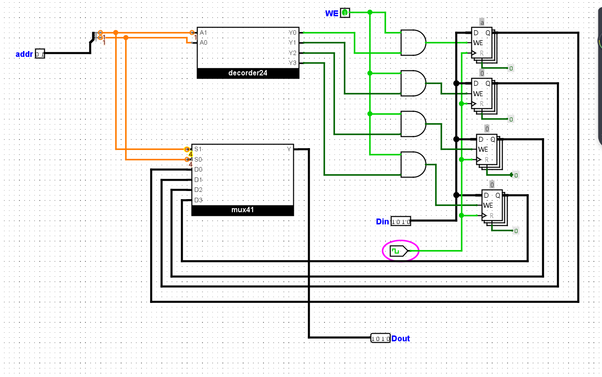 | 写地址 1 = 1010 |
| 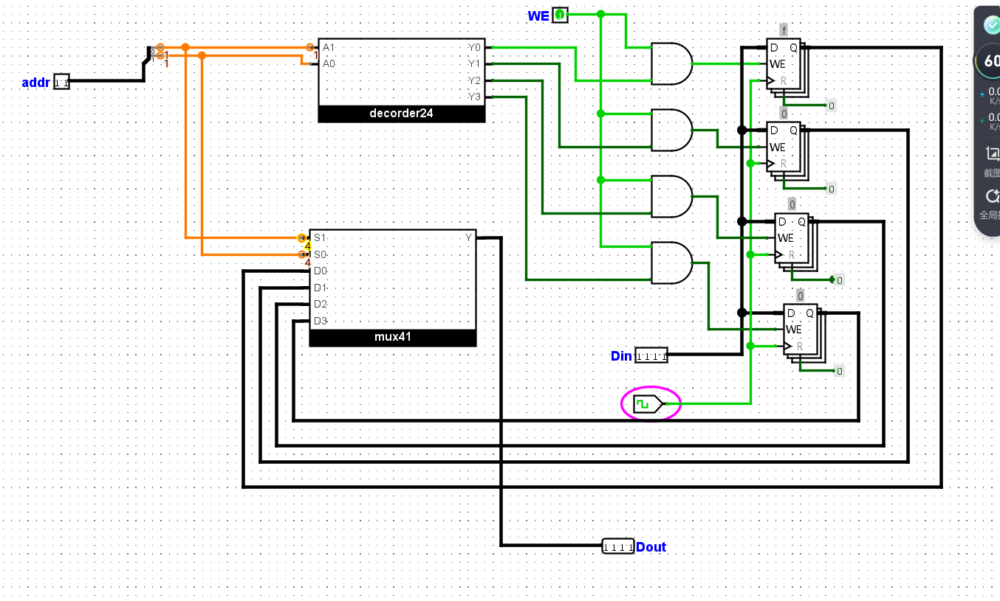 | 写地址 3 = 1111 |
| 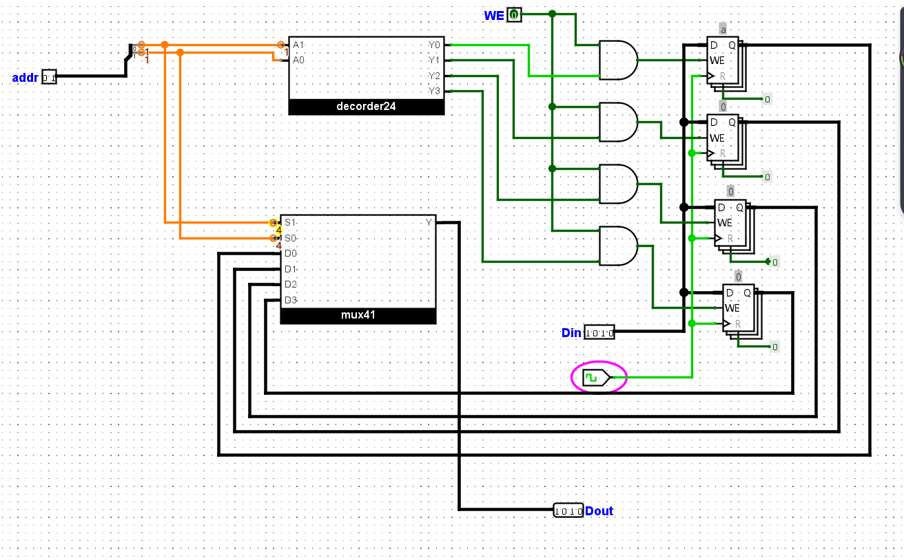 | 读地址 1 → **1010** ✅ |
| 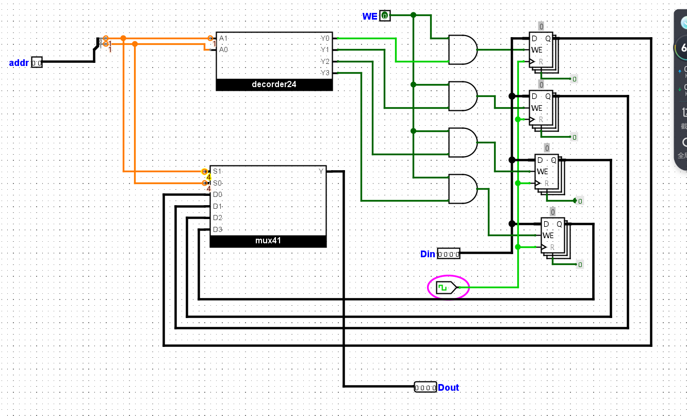 | 读地址 0 → **0000**（没写过）✅ |

#### 减法器（补码）

| 截图 | 说明 |
| --- | --- |
| 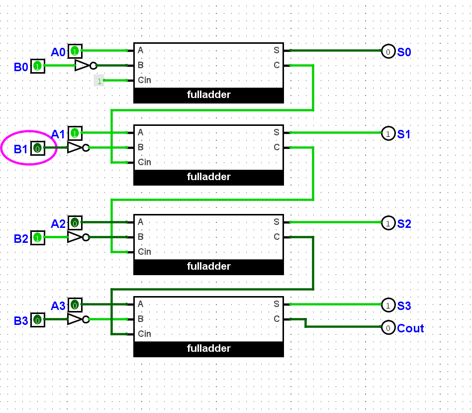 | `3 − 5 = 1110`（= **−2 的补码**）|

#### 4 位比较器（级联）

| 截图 | 说明 |
| --- | --- |
| 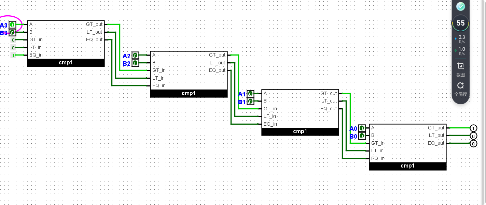 | 从高位到低位逐位比较 |

---

### 9. 实验结论

1. **"存储"的本质是反馈** —— SR 锁存器用两个门互相牵制，输入撤销后状态仍然保持。

2. **边沿触发 > 电平触发**：
   - 电平触发（锁存器）：时钟高电平期间输入会"穿透"，时序难控制
   - **边沿触发（触发器）：只在一个瞬间采样，时序清晰** —— **CPU 必须用这个**

3. **写使能（WE）是保护数据的关键**：
   - 寄存器：`WE=0` 时打拍不写入
   - RAM：`WE=0` 时所有单元都不写
   - **CPU 里"执行 add 时其他寄存器不变"就靠它**

4. **RAM 是已有模块的组合**：**译码器 + 触发器 + MUX + 写使能** —— 没有新原理，全是学过的东西。

5. **地址是"读写共用"的维度**：它回答「**在哪里**」，数据回答「**是什么**」。**n 位地址 → 2ⁿ 个单元**。

6. **补码让加法器也能做减法**：`A − B = A + ¬B + 1` —— **真实 CPU 的 ALU 就是这么设计的**。

---

## 实验六：简易处理器 sCPU

> **把前五个实验的所有零件，按「状态机模型」连成一台能执行程序的处理器。**
>
> 参考：ysyx F5「支持数列求和的简单处理器」

📄 电路文件：`sCPU.circ`

---

### 1. 目标：sISA 指令集

**三条指令，指令长度都是 8 位**：

```
 7  6 5  4 3   2 1   0
+----+----+-----+-----+
| 00 | rd | rs1 | rs2 |   R[rd] = R[rs1] + R[rs2]      add
+----+----+-----+-----+
| 10 | rd |    imm    |   R[rd] = imm（高位补 0）       li
+----+----+-----+-----+
| 11 |   addr   | rs2 |   if (R[0] != R[rs2]) PC=addr  bner0
+----+----------+-----+
```

**处理器规格**：

| 部件 | 规格 |
| --- | --- |
| **PC** | 8 位 |
| **GPR** | 4 个 × 8 位（r0~r3）|
| **指令存储器** | ROM 256×8 |
| **ALU** | 8 位加法器 |

**指令周期**（每个时钟执行一条）：

```
取指（PC → ROM）
  → 译码（拆出 opcode / rd / rs1 / rs2 / imm）
  → 执行（算结果、写 GPR）
  → 更新 PC（PC+1 或跳转）
```

---

### 2. 整体结构

```
                          ┌───────────────────────────────┐
                          │                               │
  ┌──────────┐   addr     ↓                               │
  │   PC     │──────────→[ ROM 256×8 ]                    │
  │ (8位寄存器)│               │                           │
  └──────────┘               │ 指令(8位)                 │
       ↑                     ↓                             │
       │              ┌──────────────┐                     │
       │              │  Splitter×3  │                     │
       │              └──┬────┬───┬──┘                     │
       │          opcode   rd   imm/rs1/rs2                │
       │                 │    │    │                       │
       │                 ↓    ↓    ↓                       │
       │           [控制信号] [rd译码] [Bit Extender]        │
       │                 │    │    │                       │
       │                 └────┼────┘                       │
       │                      ↓                            │
       │              ┌───────────────┐                    │
       │              │  GPR (4×8)    │                    │
       │              │ r0 r1 r2 r3   │                    │
       │              └───────────────┘                    │
       │                                                   │
       └────[ 8位加法器 PC+1 ]←─── 时钟                    │
                     └─────────────────────────────────────┘
```

**⭐ 关键洞察**：**每个部件都是前面实验中做过的**：

| sCPU 部件 | 来自哪个实验 |
| --- | --- |
| **ROM（指令存储器）** | **实验三**（七段数码管段码表）|
| **Splitter 拆指令** | **实验三** |
| **译码器（rd 译码）** | **实验二** |
| **MUX（数据选择）** | **实验二** |
| **加法器（ALU）** | **实验四** |
| **比较器（bner0）** | **实验四** |
| **寄存器（PC、GPR）** | **实验五** |
| **RAM（GPR 的原型）** | **实验五** |

---

### 3. 阶段 1：只支持 `li` 指令

**目标**：让 `li rd, imm` 能执行 —— **建立"取指 → 译码 → 写 GPR → PC+1"的主干**。

#### 三个 Splitter 的设置（**关键**）

**Splitter #1：把 8 位指令拆成三段**

| 属性 | 值 |
| --- | --- |
| `Input Bit Width` | 8 |
| `Fan Out` | 3 |
| `Bit 0` ~ `Bit 3` | **0**（→ 输出 0）|
| `Bit 4` ~ `Bit 5` | **1**（→ 输出 1）|
| `Bit 6` ~ `Bit 7` | **2**（→ 输出 2）|

**输出**：`0` = **imm(4位)**、`1` = **rd(2位)**、`2` = **opcode(2位)**

**Splitter #2：拆 rd（2 位 → 2 路 1 位）**

| 属性 | 值 |
| --- | --- |
| `Input Bit Width` | 2 |
| `Fan Out` | 2 |
| `Bit 0` | 0 |
| `Bit 1` | 1 |

**Splitter #3：拆 opcode（2 位 → 2 路 1 位）**

**设置同 #2**。

> ⚠️ **为什么需要 #2 和 #3**：**主 Splitter 输出的 `rd` 和 `opcode` 都是 2 位总线**，
> 而 `decoder24` 的输入、以及 `NOT`/`AND` 门都只能接 1 位 —— **必须再拆一层**。

#### 控制信号：判断"是不是 li 指令"

```
opcode(2位) → [Splitter#3] ─┬─ op0 ─→ [NOT] ─┐
                            │                ├─→ [AND] ─→ li_en
                            └─ op1 ──────────┘
```

**`li_en = op1 · ¬op0`** —— **只有 opcode = `10` 时才是 1**。

#### 写使能译码（**核心机制**）

**每个 GPR 的写使能**：

```
GPR_i 的 WE = (decoder24 的 Y_i) · li_en
```

**含义**：**只有「指令是 li」且「这个寄存器被 rd 选中」时，才会写入**。

**这正是 sISA 语义的硬件实现** ✅

#### 完整连线清单

| # | 从 | 到 |
| :-: | --- | --- |
| 1 | `PC.Q` | `ROM.Address` |
| 2 | `ROM.DataOut` | `Splitter#1.In` |
| 3 | `Splitter#1.输出0`（imm）| `Bit Extender.In` |
| 4 | `Bit Extender.Out`（8位）| 4 个 GPR 的 `D` |
| 5 | `Splitter#1.输出1`（rd）| `Splitter#2.In` |
| 6 | `Splitter#2.输出0` | `decoder24.A0` |
| 7 | `Splitter#2.输出1` | `decoder24.A1` |
| 8 | `Splitter#1.输出2`（opcode）| `Splitter#3.In` |
| 9 | `Splitter#3.输出0`（op0）| `NOT.In` |
| 10 | `NOT.Out` | `AND_li.In1` |
| 11 | `Splitter#3.输出1`（op1）| `AND_li.In2` |
| 12 | `AND_li.Out` | 记为 `li_en` |
| 13~16 | `decoder24.Y0~Y3` | `AND0~AND3.In1` |
| 17 | `li_en` | `AND0~AND3.In2` |
| 18~21 | `AND0~AND3.Out` | `Register0~3.WE` |
| 22 | `Clock` | `PC.Clock` |
| 23 | `Clock` | 4 个 GPR 的 `Clock` |
| 24 | 常量 `1`（8位）| `Adder_pc.B` |
| 25 | `PC.Q` | `Adder_pc.A` |
| 26 | `Adder_pc.S` | `PC.D` |
| 27 | 常量 `0` | `Adder_pc.Cin` |
| 28 | 常量 `1` | `PC.WE`（PC 每个时钟都更新）|

#### ROM 内容（**注意填十六进制**）

| 地址 | 汇编 | 二进制 | **Hex** |
| :-: | --- | :-: | :-: |
| `00` | `li r0, 5` | 10000101 | **85** |
| `01` | `li r1, 3` | 10010011 | **93** |
| `02` | `li r2, 7` | 10100111 | **A7** |
| `03` | `li r3, 1` | 10110001 | **B1** |

#### 仿真记录

| 截图 | 说明 |
| --- | --- |
| 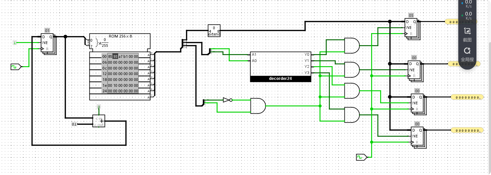 | **PC=1**：`r0 = 00000101 = 5`，其他寄存器仍为 0 —— **只有目标寄存器被写** ✅ |
| 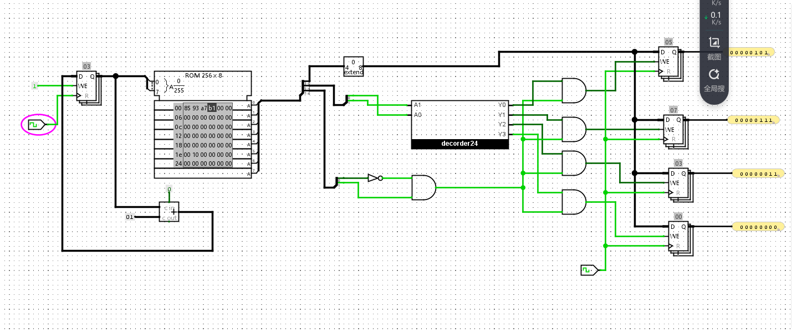 | **PC=3**：`r0=5, r1=3, r2=7` —— **多条 li 依次正确执行** ✅ |

**验证要点**：

| # | 验证什么 | 结果 |
| :-: | --- | --- |
| 1 | **PC 每个时钟 +1** | ✅ |
| 2 | **li 写进"正确的"寄存器** | ✅ |
| 3 | **只有目标寄存器被写**（其他保持 0）| ✅ |
| 4 | **非 li 指令不写 GPR**（ROM 空内容 `00`）| ✅ |

---

### 4. ⭐ 调试记录：寄存器全是 0

**现象**：阶段 1 搭完后，无论怎么打拍，**4 个 GPR 全是 0**。

#### 排查过程

**第一步：怀疑 ROM 内容**

打开 ROM 表格后发现 **内容填错了**：

```
❌ 错误填法：把二进制字符串 "10000101" 直接输进去
   （表格按十六进制解释，8 位装不下，或把每 4 位拆成两格）

✅ 正确填法：换算成十六进制，一个地址填一个字节
   li r0, 5  →  1000 0101  →  "85"
```

**修正后 ROM 输出正确**。

**第二步：`li_en` 仍为 0 → 发现缺少 Splitter**

**问题**：**主 Splitter 输出的 `opcode` 是 2 位总线**，
而 `NOT` 和 `AND` 都只能接 1 位 —— **Logisim 在两种情况都取了同一个最低位**：

```
NOT 的输入 = op0
AND 的输入 = op0        ← 同一个信号！

li_en = op0 · ¬op0 = 0   ❌ 恒等于 0
```

**修正**：**加 Splitter#3**，把 `opcode` 拆成独立的 `op1`、`op0`。
**同理**，`rd` 也要用 **Splitter#2** 拆开才能接 `decoder24`。

#### 经验总结

> **1. 调试时先怀疑"输入数据"，再怀疑"电路"** —— ROM 内容填错是最常见的低级错误。
>
> **2. 多位总线接 1 位引脚时，Logisim 不会报错**，而是静默取某一位
> —— 这会导致"电路看起来完全正确但结果全错"。**凡是 2 位以上的字段，都要用 Splitter 拆开**。
>
> **3. 逐级加 Probe 是最有效的调试手段**：
> `ROM输出 → imm → opcode → li_en → 寄存器 WE`，**哪一级不对就在那一级修**。

---

### 5. 阶段 2：加 `add` 指令

#### 5.1 用「指令译码器」产生控制信号

**讲义原话**：

> 「要识别输入的取值，最适合的电路就是译码器！由于 `opcode` 只有 2 位，我们可以使用一个 2-4 译码器，它输出的独热码可以指示当前指令属于何种指令，这样的译码器称为**指令译码器**。这组独热码通常作为**控制信号**，用于控制部分电路如何工作，从而支持不同指令的功能。」

**实现**：

```
opcode（2 位）→ 【2-4 译码器】→ Y0、Y1、Y2、Y3

Y0 = is_add     （opcode = 00）
Y1 = （空）      （opcode = 01，sISA 无此指令）
Y2 = is_li      （opcode = 10）
Y3 = is_bner0   （opcode = 11）
```

#### 5.2 GPR 加双读口

**讲义原话**：

> 「`add` 指令除了需要写入 `rd`，还需要读出 `rs1` 和 `rs2` 作为源操作数，需要同时通过**两个读端口**和一个写端口访问 GPR。」

**`gpr` 子电路的接口**：

| 端口 | 方向 | 位宽 |
| --- | :-: | :-: |
| `raddr1` | 输入 | 2 |
| `rdata1` | 输出 | 8 |
| `raddr2` | 输入 | 2 |
| `rdata2` | 输出 | 8 |
| `waddr` | 输入 | 2 |
| `wdata` | 输入 | 8 |
| `wen` | 输入 | 1 |
| `clk` | 输入 | 1 |

**内部结构**：

```
        ┌──────────────┐
raddr1 →│ MUX1（4选1） │→ rdata1
        └──────┬───────┘
               ↑
    ┌──────┬───┴───┬──────┐
    ↓      ↓       ↓      ↓
  [A0]   [A1]   [A2]   [A3]
    ↑      ↑       ↑      ↑
    └──────┴───┬───┴──────┘
               ↑
             wdata

raddr2 →│ MUX2（4选1） │→ rdata2
```

**写使能译码**：

```
waddr → 2-4 译码器 → Y0~Y3
Y_i · wen → 与门 → Reg_i 的 WE
wdata → 所有 Reg 的 D（广播）
```

> **关键**：`wdata` 同时接到 4 个寄存器的 D，但**只有 WE=1 的那个会真的写入**。

#### 5.3 写回数据选择（MUX）

**讲义原话**：

> 「如果当前指令是**加法指令**，就选择**加法器的结果**，**否则**选择 `li` 指令的**立即数**。」

**实现**（`MUX_wdata`）：

| 引脚 | 接 |
| --- | --- |
| `D0` | `imm8`（零扩展的立即数）|
| `D1` | `alu.S`（加法结果）|
| `S` | **`is_add`** |
| `Y` | `gpr.wdata` |

**对照**：

| 指令 | `is_add` | 选中 |
| :-: | :-: | --- |
| `add` | 1 | **D1 = 加法结果** ✅ |
| `li` | 0 | **D0 = 立即数** ✅ |

#### 5.4 写使能

```
wen = is_add OR is_li
```

**—— `bner0` 时 `wen = 0`（`is_add=0` 且 `is_li=0`），自动不写 GPR** ✅

#### 5.5 阶段 2 验证

**ROM（前 6 条）**：`8a 90 a0 b1 17 29`

| 拍 | PC | r0 | r1 | r2 | r3 |
| :-: | :-: | :-: | :-: | :-: | :-: |
| 1 | 1 | **10** | 0 | 0 | 0 |
| 2 | 2 | 10 | 0 | 0 | 0 |
| 3 | 3 | 10 | 0 | 0 | 0 |
| 4 | 4 | 10 | 0 | 0 | **1** |
| **5** | 5 | 10 | **1** | 0 | 1 |
| **6** | 6 | 10 | 1 | **1** | 1 |

**第 5、6 拍能算出 1** → **`add` 通路正确** ✅

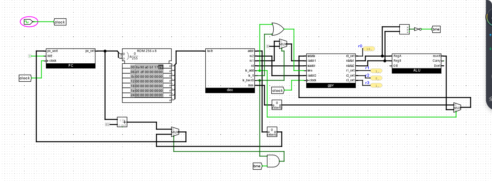

---

### 6. 阶段 3：加 `bner0` 指令

#### 6.1 ⭐ 讲义的关键设计：`raddr1` 的选择

**讲义原话**：

> 「`bner0` 还需要读出 `R[0]`，因此可以把 `0` 作为 GPR 的 `raddr1` 端口的输入。不过这个端口已经被 `add` 指令的 `rs1` 占用，但也同样可以通过**多路选择器**解决问题。」

**实现**（`MUX_raddr1`）：

| 引脚 | 接 |
| --- | --- |
| `D0` | `dec.rs1` |
| `D1` | 常量 0（2 位）|
| `S` | **`is_bner0`** |
| `Y` | `gpr.raddr1` |

**—— 这是讲义的精髓：`bner0` 时第一个读口读的是 `R[0]`** ✅

#### 6.2 比较器

| 引脚 | 接 |
| --- | --- |
| `cmp.A` | `gpr.rdata1`（**bner0 时 = `R[0]`**）|
| `cmp.B` | `gpr.rdata2`（= `R[rs2]`）|
| **`=` 输出** | **NOT 门 → `bne`** |

#### 6.3 跳转条件

```
pc_taken = is_bner0 · bne
```

**—— 只有「是 bner0」且「不相等」时才跳** ✅

#### 6.4 PC 输入 MUX

**讲义原话**：

> 「只有当前指令为 `bner0` 指令，且比较结果不相等，才将 PC 更新为 `addr` 字段，其余情况应将 PC 更新为 PC 加 1。同样地，我们可以借助**多路选择器**对 PC 寄存器的输入端进行选择。」

**实现**（`MUX_pc`）：

| 引脚 | 接 |
| --- | --- |
| `D0` | `Adder_pc.S`（PC+1）|
| `D1` | `addr8`（零扩展的跳转地址）|
| `S` | **`pc_taken`** |
| `Y` | `pc.pc_next` |

#### 6.5 `addr` 的拆分

**`addr` 是 bit 5~2** —— **跨越了 `rd`（5~4）和 `rs1`（3~2）**，所以要单独一个 Splitter：

| Splitter #3 | 值 |
| --- | --- |
| `Input Bit Width` | 8 |
| `Fan Out` | 3 |
| `Bit 0~1` | 0 |
| **`Bit 2~5`** | **1** ← `addr` |
| `Bit 6~7` | 2 |

---

### 7. ⭐ 最终验收：PC = 7，R[2] = 55

#### 7.1 程序（「1+2+…+10」）

| 地址 | Hex | 汇编 |
| :-: | :-: | --- |
| `00` | **`8a`** | `li r0, 10` |
| `01` | **`90`** | `li r1, 0` |
| `02` | **`a0`** | `li r2, 0` |
| `03` | **`b1`** | `li r3, 1` |
| `04` | **`17`** | `add r1, r1, r3` |
| `05` | **`29`** | `add r2, r2, r1` |
| `06` | **`d1`** | `bner0 r1, 4` |
| `07` | **`df`** | `bner0 r3, 7` |

#### 7.2 执行过程

| 阶段 | PC 轨迹 | r1 | r2 |
| --- | --- | :-: | :-: |
| 初始化 | 0→1→2→3→4 | 0 | 0 |
| 循环第 1 次 | 4→5→6→**4** | 1 | 1 |
| 循环第 2 次 | 4→5→6→**4** | 2 | 3 |
| … | … | … | … |
| 循环第 9 次 | 4→5→6→**4** | 10 | 45 |
| 循环第 10 次 | 4→5→6→**7** | 10 | **55** |
| 停机 | 7→7→7… | 10 | 55 |

**当 `r1 = 10 = r0` 时**：

```
bne = 0 → pc_taken = 0 → PC = 6+1 = 7
→ 执行地址 7 的 bner0 r3, 7 → 跳回 7（死循环 = 停机）
```

#### 7.3 最终状态

```
PC  = 7
r0  = 10
r1  = 10
r2  = 55   ⭐
r3  = 1
```

**—— 完全符合 ysyx F5 的验收标准** ✅

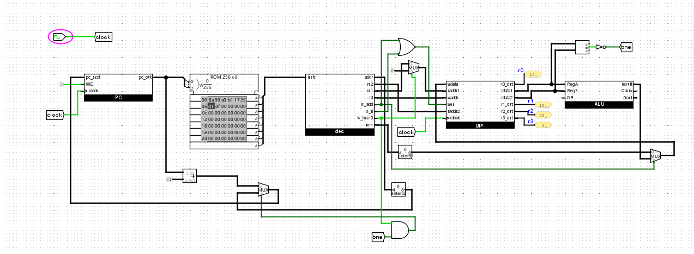
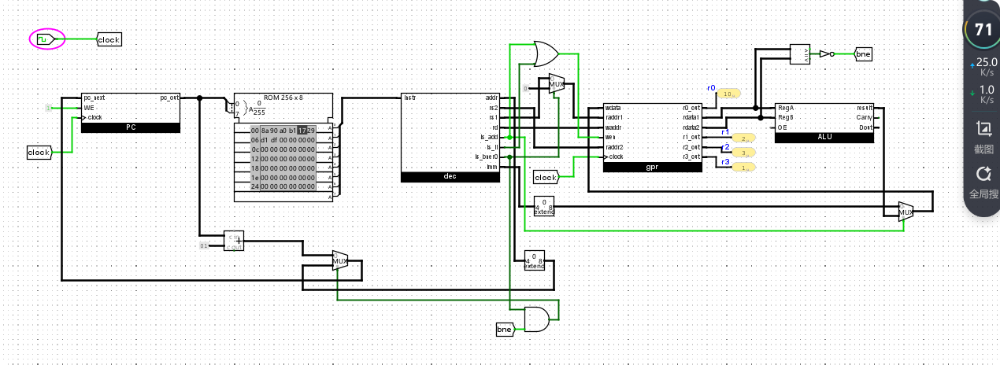

---

### 8. ⭐ 调试记录（F5 阶段，4 个坑）

#### 坑 1：Probe 接到了 `gpr` 的「输入引脚」

**现象**：打第 5 拍后，`r1`、`r2` 显示 `u`（高阻），只有 `r0`、`r3` 有值。

**原因**：**4 个 Probe 接在了 `gpr` 方块的「左边」（输入侧）** —— 读到的是 `wdata`、`wen`、`raddr2`、`clock`，**不是寄存器的值**。

**证据**：`r0` 显示 `10` —— 那正好是 `wdata` 第 1 拍写入的值 ✅

**修正**：**把 Probe 改接到 `gpr` 方块的「右边」（输出侧）** 的 `r0_out`~`r3_out`。

**教训**：

> **子电路方块「左边是输入、右边是输出」** ——
> **Probe 接错边，看到的就是「输入信号」而不是「内部状态」** ⚠️

#### 坑 2：ROM 只填了 6 条指令

**现象**：程序跑不到 `bner0`。

**原因**：ROM 的 `Contents` 里只有 `8a 90 a0 b1 17 29`，**缺 `d1`、`df`**。

**修正**：补齐 8 条。

#### 坑 3：`bne` 缺少非门（条件反了）

**现象**：跳转条件反了（"相等才跳"）。

**原因**：`bne` 直接接的是 Comparator 的 `=` 输出 —— **那是「相等」，不是「不等」**。

**修正**：**`cmp.=` → NOT 门 → `bne`**。

> 如果 Comparator 有 `≠` 输出，也可以直接用。

#### 坑 4：`ALU` 的 `result` 和 `Dout` 两个输出互相冲突

**现象**：仿真时出现**红线**（冲突）。

**原因**：`ALU` 子电路有 `result`（加法器直连）和 `Dout`（经过三态缓冲器）**两个 8 位输出** ——
如果在顶层都接到同一处，**两个输出驱动同一根线** → 红线。

**修正**：**只用其中一个**（建议 `result`），另一个悬空。

---

### 9. 必做题

#### 必做题 1：计算 10 以内的奇数之和（1+3+5+7+9）

**程序**：

```
0: li r0, 11      # 上界（比 9 大的第一个奇数）
1: li r1, 1       # 当前奇数
2: li r2, 0       # 累加和
3: li r3, 2       # 步长
4: add r2, r2, r1 # sum += 当前奇数
5: add r1, r1, r3 # 下一个奇数
6: bner0 r1, 4    # r1 ≠ 11 就继续循环
7: bner0 r3, 7    # 停机
```

**机器码**：`8b 91 a0 b2 09 1d d1 df`

**结果**：**`r2 = 25`** = 1+3+5+7+9 ✅

**对「存储程序」思想的认识**：

> 程序就是**一串指令**，CPU 只是**机械地按指令更新状态**。
> 同一套硬件（3 条指令）**通过不同的指令组合**，就能完成不同的任务 ——
> **这正是「通用计算机」的本质：硬件不用变，变的是程序。**

#### 必做题 2：「设计一条让 10 个数相加的指令」是否合理？

**答案**：**不合理**。理由：

| 角度 | 说明 |
| --- | --- |
| **程序** | 硬编码「10 个数」无法扩展到 N 个数，失去通用性 |
| **ISA** | 为特定问题加指令，会让指令集臃肿 |
| **CPU 电路** | 需要 10 个输入的加法器，**硬件成本剧增** |
| **对比** | **用「循环 + 跳转」只需 3 条指令就能算任意 N** ✅ |

**核心思想**：

> **CPU 应该提供「小而通用」的指令集，让程序去组合它们** ——
> **而不是为每个具体问题加一条指令。**

---

## 实验七：ysyx F6 —— sISA v2.0

> 配套电路：`F6.circ`（在 `F5.circ` 基础上改 3 处）
>
> 验证结果：**`li` 的 4 种 `s` 全部正确**（`r0` = 3 / 12 / 48 / 192）

---

### 1. 为什么需要 v2.0

**F5 的 sISA 有两个「硬伤」**（讲义原文）：

| 局限 | 例子 |
| --- | --- |
| **`li` 只能装 `0~15`** | **装 192 要 1 条 `li` + 6 条 `add`** |
| **`bner0` 只能跳到 `0~15`** | 绝对地址，范围太小 |

**讲义里那段「装 192」的例子**：

```
0: li r0, 3
1: add r0, r0, r0  # r0 = 6
2: add r0, r0, r0  # r0 = 12
3: add r0, r0, r0  # r0 = 24
4: add r0, r0, r0  # r0 = 48
5: add r0, r0, r0  # r0 = 96
6: add r0, r0, r0  # r0 = 192
```

**7 条指令才能装一个常数** —— **效率太低**。

**F6 的增强思路**：**只改这两条指令的「操作数含义」，其余（取指、操作码译码、执行、更新 PC）全不变**。

---

### 2. 指令格式（sISA v2.0）

#### `li`（增强）

```
 7  6 5  4 3  2 1  0
+----+----+----+----+
| 10 | rd | s  |imm |
+----+----+----+----+

       R[rd] = imm << (s << 1)
```

**`s` 决定 `imm`（2 位）放在 8 位的哪一段**：

| `s` | 8 位数据布局 | `imm=3` 时的值 |
| :-: | :-: | :-: |
| `00` | `00 00 00 imm` | **3** |
| `01` | `00 00 imm 00` | **12** |
| `10` | `00 imm 00 00` | **48** |
| `11` | `imm 00 00 00` | **192** |

**—— 装 192 从「7 条指令」降到「1 条」** ✅

**讲义原文**：

> 「同样是装入 `192`，由于 `192 = 0b11000000`，相当于将 `11` 放置在第 6 和第 7 位。
> 因此，如果使用增强之后的 `li` 指令，只需要一条指令即可实现装入：`10001111`」

#### `bner0`（增强）

```
 7  6 5        2 1  0
+----+----------+----+
| 11 |  offset  |rs2 |
+----+----------+----+

       if (R[0] != R[rs2])  PC = PC + sign_ext(offset)
```

**`offset` = 相对当前 PC 的偏移**（4 位补码，范围 **-8 ~ +7**）。

**⚠️ 必须用「符号扩展」**（讲义原文）：

> 「由于 `offset` 字段需要支持负数，因此需要采用**补码**表示。
> 在补码中，对于负数，进行**零扩展**前后，真值会发生变化。
> 例如，4 位补码 `0b1111` 的真值是 `-1`，对其进行零扩展后得到 5 位补码 `0b01111`，真值是 `15`。
> **为了保证扩展后 `offset` 的真值保持不变，`bner0` 指令需要对 `offset` 进行符号扩展。**」

---

### 3. 三个改动（**只改 `dec` 和顶层**）

#### 改动 1：`dec` 的字段拆分

| F5 | F6 |
| --- | --- |
| `imm` = bit 3~0（4 位）| **`imm` = bit 1~0（2 位）** |
| — | **`s` = bit 3~2（2 位）** ⭐ 新增 |
| `addr` = bit 5~2（4 位）| **`offset` = bit 5~2（4 位）**（改名）|

**Splitter #2 的位段设置**：

| 属性 | 值 |
| --- | :-: |
| `Bit 0~1` | **0**（`imm`，2 位）|
| `Bit 2~3` | **1**（`s`，2 位）⭐ |
| `Bit 4~7` | 2（不用）|

**`dec` 的完整输出（F6 版）**：

| 端口 | 位宽 | 变化 |
| --- | :-: | --- |
| `is_add` | 1 | 不变 |
| `is_li` | 1 | 不变 |
| `is_bner0` | 1 | 不变 |
| `rd` | 2 | 不变 |
| `rs1` | 2 | 不变 |
| `rs2` | 2 | 不变 |
| **`imm`** | **2** | **4 → 2** |
| **`s`** | **2** | **新增** ⭐ |
| **`offset`** | **4** | 改名（原 `addr`）|

#### 改动 2：复用 PC 加法器（删掉 `MUX_pc`）

**讲义原话**：

> 「之前为了计算 PC+1，已经使用了一个加法器，考虑到 `bner0` 指令跳转时，并不需要计算 PC+1，
> 因此可以考虑**让跳转目标的计算复用这个加法器**。但为了复用它，你需要考虑如何添加额外的控制信号。」

**F5 的结构**（2 个 MUX 串联）：

```
PC.Q ──→ Adder_pc.A
常量1 ──→ Adder_pc.B
Adder_pc.S ──→ MUX_pc.D0 ─┐
addr8      ──→ MUX_pc.D1 ─┴─→ MUX_pc.Y ──→ PC.pc_next
pc_taken   ──→ MUX_pc.S
```

**F6 的结构**（1 个 MUX 移到加法器 B 端）：

```
PC.Q ──→ Adder_pc.A
        MUX_addB.Y ──→ Adder_pc.B     ← 新增
Adder_pc.S ──────────→ PC.pc_next      ← 直连（删掉 MUX_pc）
```

**`MUX_addB` 的接法**：

| 引脚 | 接 | 说明 |
| --- | --- | --- |
| **`D0`** | **常量 1（8 位）** | `pc_taken=0` 时选它 → **PC+1** |
| **`D1`** | **`offset8`**（符号扩展）| `pc_taken=1` 时选它 → **PC+offset** |
| **`S`** | **`pc_taken`**（= `is_bner0 AND bne`）| ⚠️ 不能只接 `is_bner0` |
| **`Y`** | **`Adder_pc.B`** | |

**⚠️ 关键**：**`S` 必须是 `pc_taken`** —— 如果只接 `is_bner0`，
那 `bner0` 但「相等」时也会偏移（错的）。**相等时必须走 `PC+1`** ✅

**⚠️ 操作顺序**（避免中间状态出错）：

```
① 先断「常量1 → Adder_pc.B」
② 放 MUX_addB，接 D0/D1/S
③ MUX_addB.Y → Adder_pc.B
④ Adder_pc.S → PC.pc_next（直连）
⑤ 删掉 MUX_pc
```

#### 改动 3：`li` 的移位（`Shifter`）

**F5**：

```
imm（4 位）→ Bit Extender（Zero, 4→8）→ imm8 → MUX_wdata.D0
```

**F6**：

```
imm（2 位）→ Bit Extender（Zero, 2→8）→ Shifter（左移 s*2）→ imm8 → MUX_wdata.D0
```

**`Shifter` 的属性**：

| 属性 | 值 |
| --- | --- |
| `Data Bits` | **8** |
| `Shift Type` | **Logical Left**（逻辑左移）|

**`s * 2` 的生成**（**用 Splitter 拼接**）：

```
Splitter（Facing = West，合并模式）
  Input Bit Width = 3
  Fan Out = 2
  Bit 0   = 1        ← 常量 0（1 位）
  Bit 1~2 = 0        ← dec.s（2 位）
  
  输出 3 位 = {s, 0} = s*2 ✅
```

**⚠️ `s*2` 就是 `s` 左移 1 位** —— 因为 `imm` 是 2 位，每移一段要移 2 位。

---

### 4. 验证：4 种 `s` 全对

**ROM 内容**：

| 地址 | Hex | 汇编 | `s` | 期望 `r0` |
| :-: | :-: | --- | :-: | :-: |
| `00` | **`83`** | `li r0, 3` | `00` | **3** |
| `01` | **`87`** | `li r0, 3` | `01` | **12** |
| `02` | **`8b`** | `li r0, 3` | `10` | **48** |
| `03` | **`8f`** | `li r0, 3` | `11` | **192** |

**逐拍结果**：

| 拍 | PC | `r0` | 说明 |
| :-: | :-: | :-: | --- |
| 1 | 1 | **3** | `3 << 0` |
| 2 | 2 | **12** | `3 << 2` |
| 3 | 3 | **48** | `3 << 4` |
| 4 | 4 | **192** | `3 << 6` |

**—— 4 种 `s` 全部正确** ✅

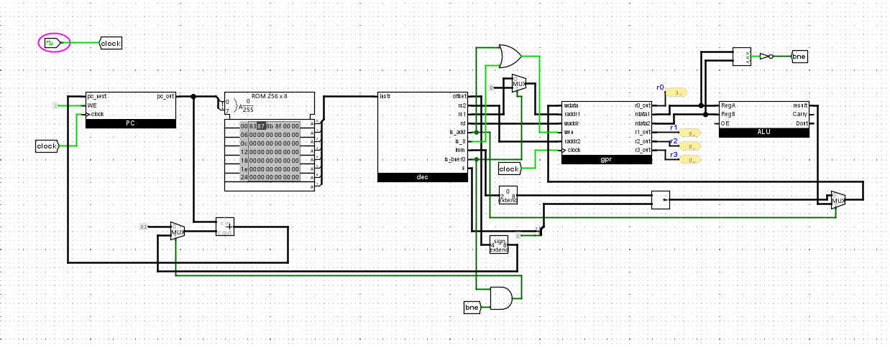
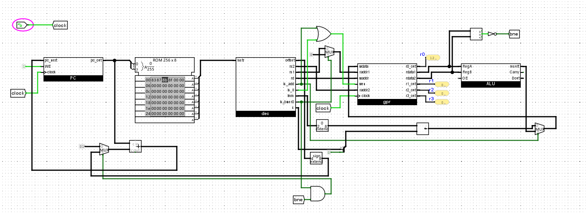
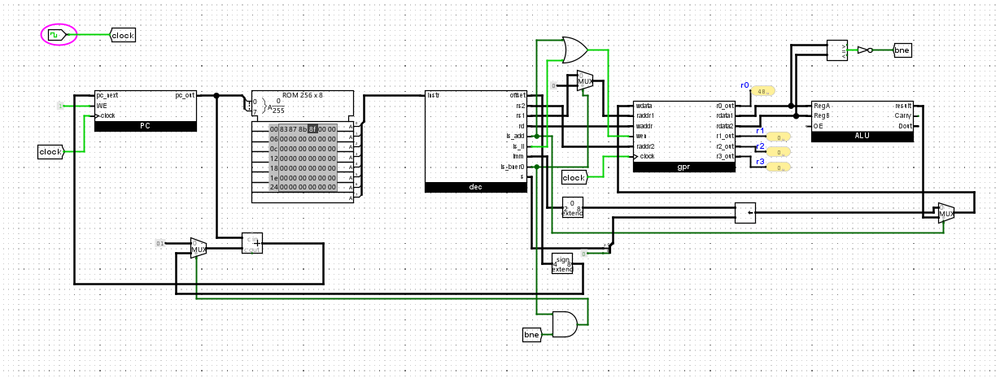
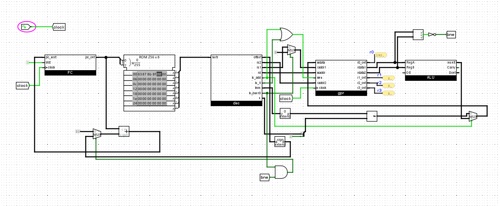

---

### 5. 调试记录：`MUX_wdata.D0` 接成了 `offset8`

**现象**：第一拍后 **`r0 = 255`**。

**原因**：**`MUX_wdata` 的 `D0` 本应接 `imm8`（`Shifter` 输出），却接成了 `offset8`（`offset` 的符号扩展）**。

**为什么是 255**：

```
offset = 1111（4 位补码 = -1）
   ↓ Sign Extend
offset8 = 11111111 = 255
```

**—— `li` 指令把 `offset8` 写进了 `r0`** ❌

**修正**：

```
① 删掉「offset8 → MUX_wdata.D0」的线
② Shifter.Output → MUX_wdata.D0
③ 确认 offset8 只接 MUX_addB.D1
```

**教训**：

> **两个 Bit Extender 的输出去向完全不同**：
>
> | Bit Extender | 类型 | 输出 → |
> | --- | :-: | --- |
> | **`imm` 的** | Zero Extend | **`Shifter.Data`** |
> | **`offset` 的** | Sign Extend | **`MUX_addB.D1`** |
>
> **都不能直接接 `MUX_wdata.D0`** ⚠️

**防止方法**：**给 MUX 加 `Label`**（属性栏），标成 `addB` / `wdata` / `raddr1`，一眼能分清。

---

### 6. 实验结论

1. **`li` 增强后，装大常数从 7 条指令降到 1 条** ——
   **体现了「指令编码设计」对程序效率的直接影响**。

2. **`bner0` 从「绝对地址」改成「相对偏移」** ——
   **代码可以整体搬移（位置无关）**，这是现代处理器的标准做法。

3. **符号扩展 vs 零扩展，取决于「数据是否有符号」**：
   - **`offset` 有符号**（能是负数）→ **Sign Extend**
   - **`imm` 无符号** → **Zero Extend**

4. **复用加法器** —— **一个硬件部件，在输入端加一个 MUX 就能干两件事**，
   这是数字设计的常用手法（省硬件、省面积）。

---

### 7. F6 的完成情况

| F6 讲义内容 | 状态 |
| --- | :-: |
| **sISA v2.0**（`li` 的 `s`、`bner0` 的 `offset`）| ✅ **完成并验证** |
| 输入输出指令 | ⏳ 未做 |
| 让 sCPU 支持输入输出 | ⏳ 未做 |
| 迈向现代化的处理器设计 | ⏳ 未做 |

**—— 已完成 F6 的核心难点（sISA v2.0）** ✅

---

## 实验八：ysyx F6 —— 输入输出

> 配套电路：`wholeF6.circ`（48.2 KB，完整版）
>
> 验证：**`in` 读拨码、`out` 写 LED / 七段，全部通过**

---

### 1. 目标

**F5/F6 的 sCPU 只能「跑完看寄存器」** —— 讲义原话：

> 「为了检查运行结果，你是直接观察 PC 寄存器和 GPR 的值。但在**真实的处理器芯片**中，我们**很难直接观察芯片内部的状态**。事实上，用户通常是**通过输入输出方式**与处理器芯片进行交互。」

**F6 的目标**：**给 sCPU 加上输入输出，让它能跟外部设备交互** ✅

---

### 2. sISA v3.0（最终 4 条指令）

```
 7  6 5  4 3   2 1   0
+----+----+---+-------+
| 00 | rd | rs1 | rs2 |    R[rd] = R[rs1] + R[rs2]
+----+----+---+-------+
| 01 | rd |i/o|  idx  |    R[rd] <=> dev[idx]
+----+----+---+-------+
| 10 | rd | s |  imm  |    R[rd] = imm << (s << 1)
+----+----+---+-------+
| 11 |  offset  | rs2 |    if (R[0] != R[rs2]) PC = PC + sign_ext(offset)
+----+----------+-----+
```

**—— `01` 正是 F5 里唯一空着的操作码槽位** ✅

---

### 3. `io` 指令（新增）

```
 7  6 5  4 3   2 1   0
+----+----+---+-------+
| 01 | rd |i/o|  idx  |    R[rd] <=> dev[idx]
+----+----+---+-------+
```

| 字段 | 位置 | 位宽 | 含义 |
| --- | :-: | :-: | --- |
| `opcode` | bit 7~6 | 2 | **`01`** |
| `rd` | bit 5~4 | 2 | 寄存器 |
| **`i/o`** | **bit 3** | **1** | **0 = 输入，1 = 输出** |
| **`idx`** | **bit 2~0** | **3** | **设备编号（0~7）** |

**行为**：

| `i/o` | 操作 | 数据流向 |
| :-: | --- | --- |
| **0** | **输入** | **`dev[idx]` → `R[rd]`** |
| **1** | **输出** | **`R[rd]` → `dev[idx]`** |

**指令编码速查**：

| 汇编 | 二进制 | Hex |
| --- | :-: | :-: |
| `in r0, 拨码` | `01 00 0 000` | **`40`** |
| `in r1, 按钮` | `01 01 0 001` | **`51`** |
| `out r0, LED` | `01 00 1 000` | **`48`** |
| `out r2, 七段` | `01 10 1 001` | **`69`** |

---

### 4. 设备关联（讲义指定）

| `i/o` | `idx` | 设备 |
| :-: | :-: | --- |
| **1** | `000` | **输出到 LED** |
| **1** | `001` | **输出到七段数码管** |
| **0** | `000` | **从拨码开关输入** |
| **0** | `001` | **从按钮输入** |

**讲义要点**：

> 「通常**不会从 LED 输入**，也**不会输出到拨码开关**，因此可以让它们**复用同一个设备编号 `0b000`**。」

**—— 4 个设备，2 个编号，靠 `i/o` 位区分** ✅

**⚠️ 关键设计点**：**`io` 的 `rd` 在 bit 5~4**，而 `gpr.raddr1` 平时接 `rs1`（**bit 3~2**）——
**所以 `MUX_raddr1` 必须再加一路 `rd`**（见 5.3）。

---

### 5. 五个改动

#### 5.0 `dec` 加 3 个输出

| 端口 | 位宽 | 说明 |
| --- | :-: | --- |
| **`is_io`** | 1 | **译码器 `Y1`**（opcode=`01`）|
| **`io_dir`** | 1 | bit 3 |
| **`idx`** | 3 | bit 2~0 |

**新增 Splitter #4**：

| 属性 | 值 |
| --- | :-: |
| `Input Bit Width` | 8 |
| `Fan Out` | 3 |
| **`Bit 0~2`** | **0** → `idx` |
| **`Bit 3`** | **1** → `io_dir` |
| `Bit 4~7` | 2（不用）|

**—— F5 里空着的 `Y1` 终于用上了** ✅

#### 5.1 `MUX_wdata` 从 2 选 1 → 3 选 1

```
D0 ← imm8          （li）
D1 ← alu.result    （add）
D2 ← io_rdata      （io 输入）⭐
D3 ← 常量 0

S（2 位）= {S1, S0}
  S1 = is_io AND NOT io_dir
  S0 = is_add
```

**对照**：

| `S1` | `S0` | `S` | 选中 |
| :-: | :-: | :-: | --- |
| 0 | 0 | `00` | `imm8`（li）|
| 0 | 1 | `01` | `alu.result`（add）|
| **1** | X | `1X` | **`io_rdata`**（io 输入）|

#### 5.2 `wen` 加一路

```
wen = is_add OR is_li OR (is_io AND NOT io_dir)
                          └──────┬──────┘
                             复用 5.1 的 S1
```

**—— `io` 输入时写 `R[rd]`，输出时不写** ✅

#### 5.3 ⭐ `MUX_raddr1` 从 2 选 1 → 3 选 1（**关键！**）

**为什么**：**`io` 要读 `R[rd]`（bit 5~4）**，而原来只接 `rs1`（bit 3~2）—— **两者不同** ❌

```
D0 ← rs1            （add）
D1 ← 常量 0          （bner0）
D2 ← rd             （io）⭐
D3 ← 常量 0

S（2 位）= {is_io, is_bner0}
```

**对照**：

| `is_io` | `is_bner0` | `S` | 选中 | 读到 |
| :-: | :-: | :-: | --- | --- |
| 0 | 0 | `00` | `rs1` | **R[rs1]**（add）|
| 0 | 1 | `01` | `0` | **R[0]**（bner0）|
| **1** | X | `1X` | **`rd`** | **R[rd]**（io）⭐ |

#### 5.4 LED 锁存器

```
led_reg（Register，8 位）
  D   ← gpr.rdata1（= R[rd]）
  WE  ← is_io AND io_dir AND (idx == 000)
  clk ← Clock
  Q   → 8 个 LED
```

**`idx == 000` 的检测**：**3 输入 NOR 门**（`NOR(0,0,0) = 1`，其余为 0）✅

**—— 输出必须"锁存"，否则 LED 只亮一瞬** ⚠️

#### 5.5 七段锁存器 + `seg7` 子电路

```
seg7_reg（Register，8 位）
  D   ← gpr.rdata1
  WE  ← is_io AND io_dir AND (idx == 001)
  Q   → 低 4 位 → seg7 子电路 → 七段数码管
```

**`seg7` 子电路**（自己搭的，8 步）：

```
data（4 位）→ ROM（4→7）→ Splitter（7→7）→ a~g（7 个输出）
```

**ROM 内容**（0~9 的段码）：

```
addr/data: 4 7
7e 30 6d 79 33 5b 5f 70
7f 7b
```

**⚠️ 只支持 0~9**（没有 A~F）✅

#### 5.6 输入 MUX

```
io_rdata = idx[0] ? 按钮 : 拨码开关
```

**2 选 1 MUX**：

| 引脚 | 接 |
| --- | --- |
| `D0` | **拨码开关**（8 个 Pin + Splitter 合并）|
| `D1` | **按钮**（8 个 Pin + Splitter 合并）|
| `S` | **`idx[0]`** |
| `Y` | `io_rdata` → `MUX_wdata.D2` |

---

### 6. 验证

#### 程序 1：读拨码

| 地址 | Hex | 汇编 |
| :-: | :-: | --- |
| `00` | **`40`** | `in r0, 拨码` |
| `01` | **`FF`** | `bner0 r3, -1` |

**拨码 = 5，打 1 拍 → `r0 = 5`** ✅

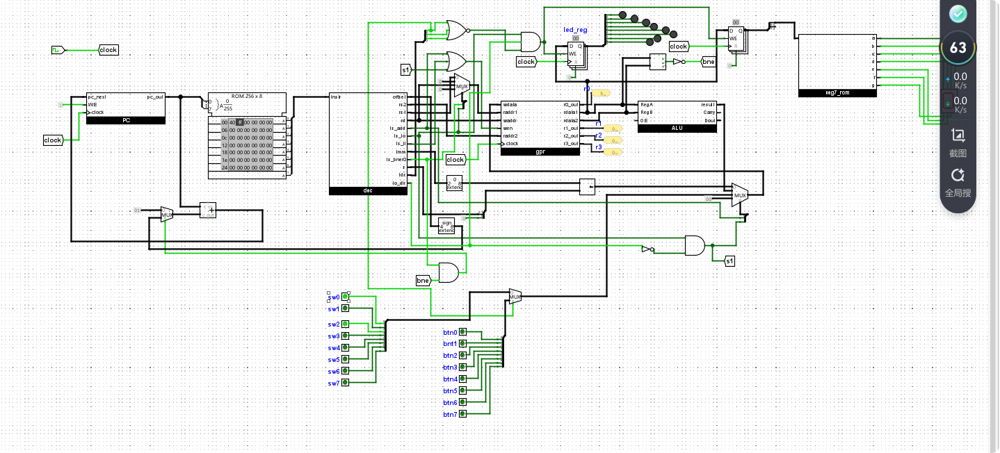

#### 程序 2：写 LED / 七段

| 地址 | Hex | 汇编 |
| :-: | :-: | --- |
| `00` | **`83`** | `li r0, 3` |
| `01` | **`48`** | `out r0, LED` |
| `02` | **`49`** | `out r0, 七段` |
| `03` | **`FF`** | `bner0 r3, -1` |

**打 3 拍 → LED 低 2 位亮、数码管显示 `3`** ✅

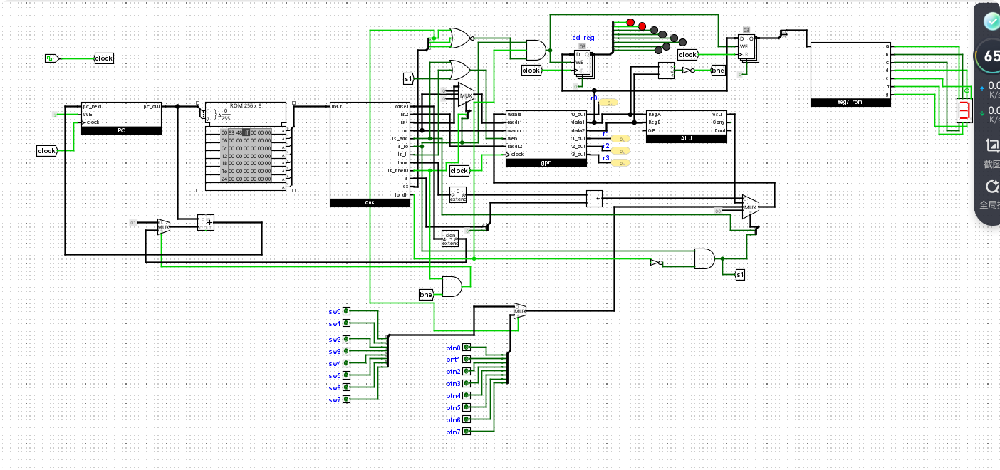

#### 程序 3：完整循环（最终演示）

| 地址 | Hex | 汇编 |
| :-: | :-: | --- |
| `00` | **`40`** | `in r0, 拨码` |
| `01` | **`48`** | `out r0, LED` |
| `02` | **`49`** | `out r0, 七段` |
| `03` | **`F7`** | `bner0 r3, -3`（跳回 0）|

**⚠️ `F7` 怎么算**：

```
目标地址 = 0，当前 PC = 3
offset = 0 - 3 = -3 = 1101（4 位补码）
→ | 11 | 1101 | rs2=11 | = 1111 0111 = F7
```

**效果**：**拨码一变，LED 和数码管同步跟着变** ✅

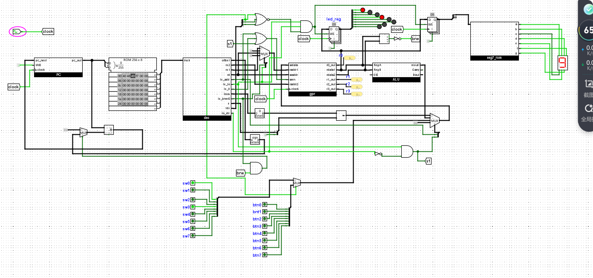

---

### 7. 调试记录（3 个坑）

#### 坑 1：`io` 读到的是 `R[rs1]` 而不是 `R[rd]`

**现象**：`in r0, 拨码` 后 `r0` 是错的。

**原因**：**`io` 的 `rd` 在 bit 5~4**，但 **`MUX_raddr1` 只接 `rs1`（bit 3~2）** —— **两者不同** ❌

**修正**：`MUX_raddr1` 从 2 选 1 改成 3 选 1，加一路 `dec.rd`。

**教训**：

> **同一个位段，不同指令可以有不同含义** ——
> **译码时要按"当前指令"解释，不能固定成一个字段** ⚠️

#### 坑 2：`bner0` 的 offset 算错，循环跳错地方

**现象**：程序不循环，或者跳到中间。

**原因**：**`bner0` 是「相对偏移」**（不是绝对地址）：

```
要跳回地址 0，当前 PC = 3
offset = 0 - 3 = -3（不是 0）
```

**修正**：**`F7` = `| 11 | 1101 | 11 |`**（offset = -3）✅

**教训**：

> **`bner0` 的 offset 是「相对当前 PC」** —— **算的时候用「目标 − 当前」** ⚠️

#### 坑 3：`MUX_wdata.D2` 接成了常量 0

**现象**：`in` 读进来的值一直是 0。

**原因**：**5.1 时 `D2` 用常量 0 占位**，**5.6 忘了改接 `io_rdata`** ❌

**修正**：`MUX_wdata.D2 ← io_rdata` ✅

**教训**：

> **占位用的常量，改动完成后一定要"回头替换"** ——
> 最好在占位上打 `Label`（比如 `TODO_D2`），一眼能看到还没接 ⚠️

---

### 8. 实验结论

1. **`io` 指令只用一个操作码槽位** —— **`i/o` 位切换方向、`idx` 选设备** ——
   **一条指令搞定"读"和"写"**。这是"指令编码设计"的典范：
   **用最少的位数表达最多的功能**。

2. **设备编号"复用"** —— **LED 和拨码开关共用 `idx=000`**，
   因为**方向不同不会冲突**。这是"资源复用"的思路。

3. **`rd` 和 `rs1` 位段重叠的教训** ——
   `io` 的 `rd` 在 bit 5~4，`add` 的 `rs1` 在 bit 3~2，
   **同一位段在不同指令下含义不同** → **必须用 MUX 按指令切换** ⚠️

4. **"锁存"是输出设备的关键** ——
   `io` 指令只持续 1 拍，**不锁存的话 LED 只亮一瞬**。
   用 `Register` 锁存后，**输出能保持到下次写** ✅

5. **sCPU 从「能算」进化到「能交互」** ——
   F5 只能"跑完看寄存器"，F6 能"读外设、写外设"，
   **这才是真实处理器的工作方式** ✅

---

### 9. F6 完成情况

| F6 讲义内容 | 状态 |
| --- | :-: |
| **sISA 指令的增强**（`li` 的 `s`、`bner0` 的 `offset`）| ✅ 实验七 |
| **输入输出指令**（`io`）| ✅ **实验八** |
| **让 sCPU 支持输入输出**（设备关联）| ✅ **实验八** |
| 迈向现代化的处理器设计 | 📖 阅读性质，无需电路 |

**—— 2607 版 F6 的电路部分全部完成** ✅

---

## 遇到的问题与解决

### 问题 1：连线没有真正连到元件引脚上

**现象**：进入仿真模式后，点击输入引脚，输出**毫无反应**；或者线显示为**蓝色**。

**原因**：线的端点**没有精确落在元件的引脚**上（差了几个像素），Logisim 视为**未连接**。

**判断方法**：在编辑模式下**拖动元件**，观察线是否跟着移动 ——
- 跟着动 = 已连接 ✅
- 不动 = 未连接 ❌

**解决**：拖动线的端点，**看到绿色小圆点**（吸附提示）后再松手。

### 问题 2：`Ctrl + S` 覆盖了原文件

**现象**：在 `and.circ` 上画完非门，按 `Ctrl+S`，结果 `and.circ` 里装的是非门。

**原因**：`Ctrl + S` 是「**保存**」（覆盖当前文件），不是「**另存为**」。

**解决**：做新电路时，**先 `File → Save As...` 另存为新文件**，**再修改内容**。

| 操作 | 效果 |
| --- | --- |
| `Ctrl + S` | 保存（覆盖当前文件）|
| `File → Save As...` | 另存为（新建文件）|

---

## 实验结论

1. **六种基本逻辑门**都能在 Logisim 中正确实现并验证真值表。
2. **异或门（XOR）值得特别注意** —— 它的"不同才 1"特性正是**加法器**的核心（`1+1=0 进 1`），后续做加法器时会用到。
3. **连线必须精确连到引脚上** —— 这是数字电路仿真中最容易犯的错误，用"拖动元件看线是否跟随"可以快速判断。
4. **模块化习惯**：每种门单独存一个文件，清晰、便于验证、便于复用。

---

## 下一步计划

| 阶段 | 内容 | 状态 |
| --- | --- | --- |
| 实验一 | 六种基本逻辑门 | ✅ 完成 |
| 实验二 | 译码器、编码器、数据选择器 | ✅ **完成** |
| 实验三 | 七段数码管译码器（ROM 查表）| ✅ **完成** |
| 实验四 | 加法器、比较器 | ✅ **完成** |
| 实验五 | 触发器、寄存器、计数器、RAM | ✅ **完成** |
| 实验六 | 简易处理器 sCPU（ysyx F5）| ✅ **完成（PC=7, R[2]=55）** |
| **实验七** | **ysyx F6 —— sISA v2.0** | ✅ **完成（li 的 4 种 s 全通过）** |
| **实验八** | **ysyx F6 —— 输入输出（io）** | ✅ **完成（读拨码 / 写 LED / 七段）** |
| 实验九 | 设计报告 + 现场演示 | ⏳ 待做 |
| 实验四 | 触发器、寄存器、计数器 | ⏳ 待做 |
| **正式作业** | **简易 CPU（sCPU）—— ysyx F5** | ⏳ 待做 |
| 加分项 | 输入输出（ysyx F6）| ⏳ 待做 |

---

*实验日期：2026 年 10 月*
